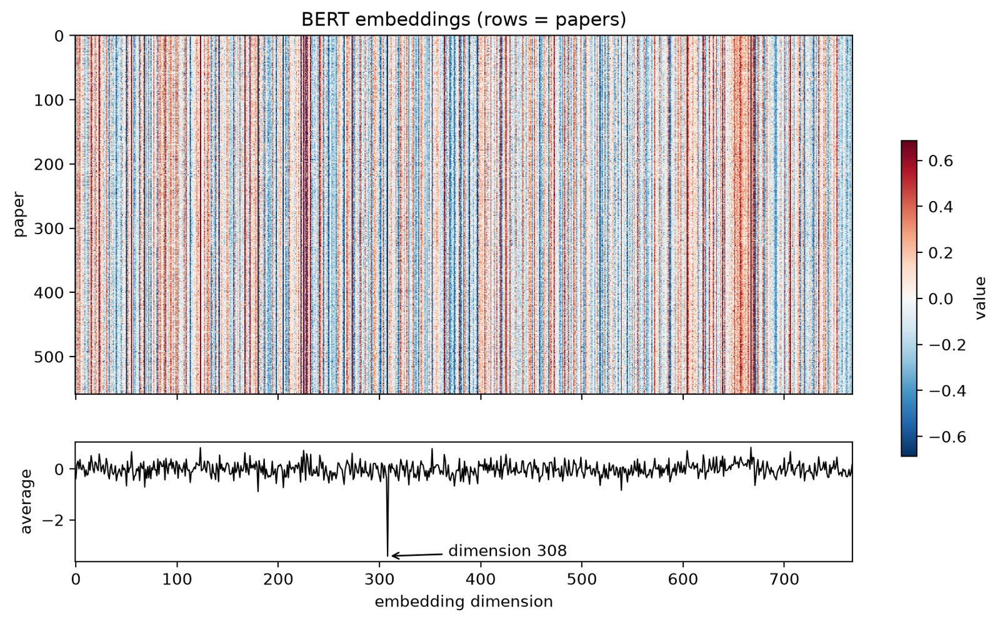
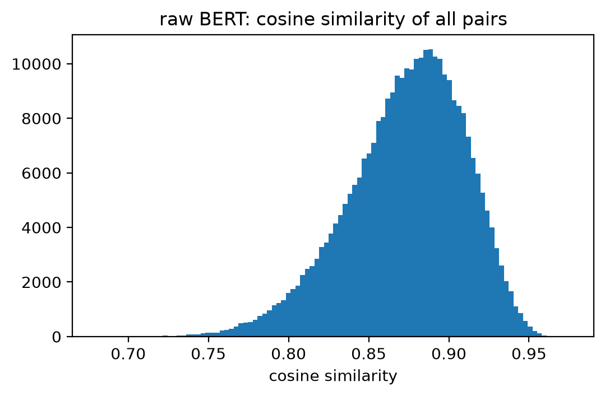
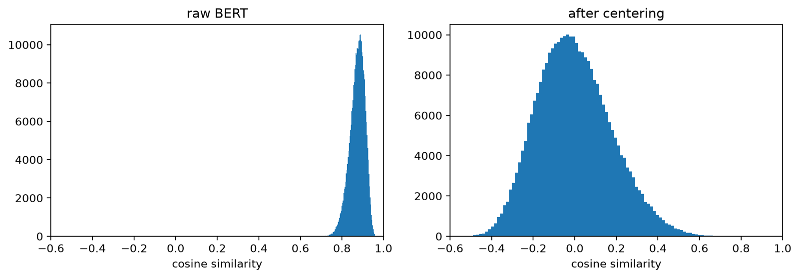
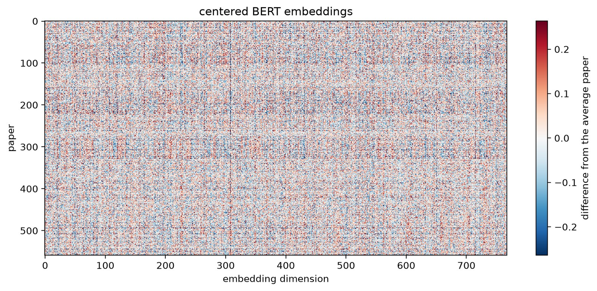
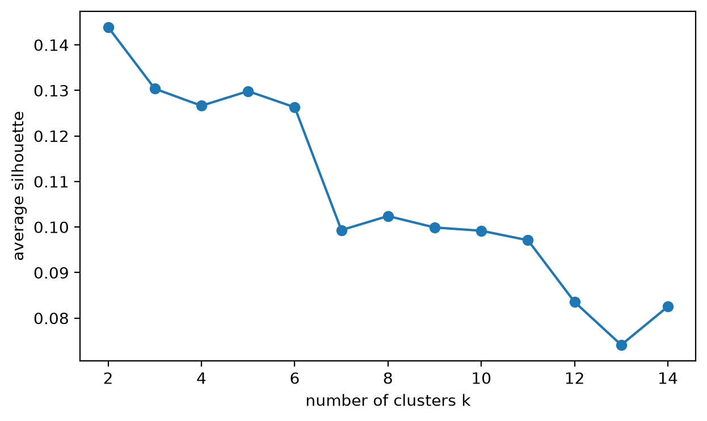
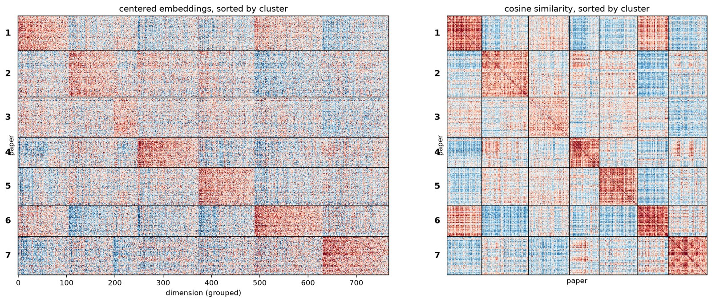
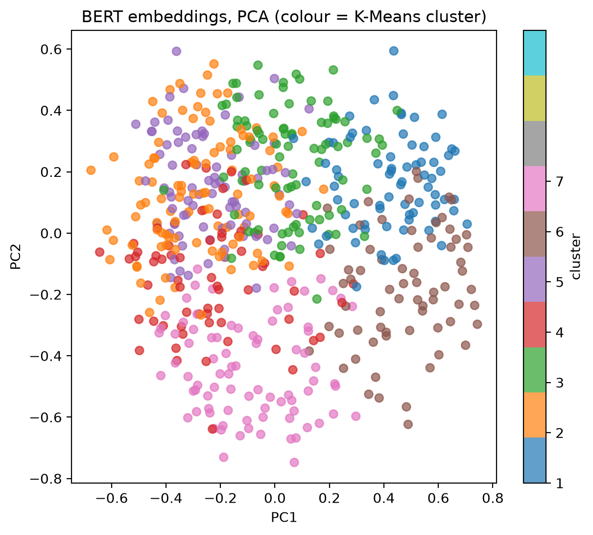
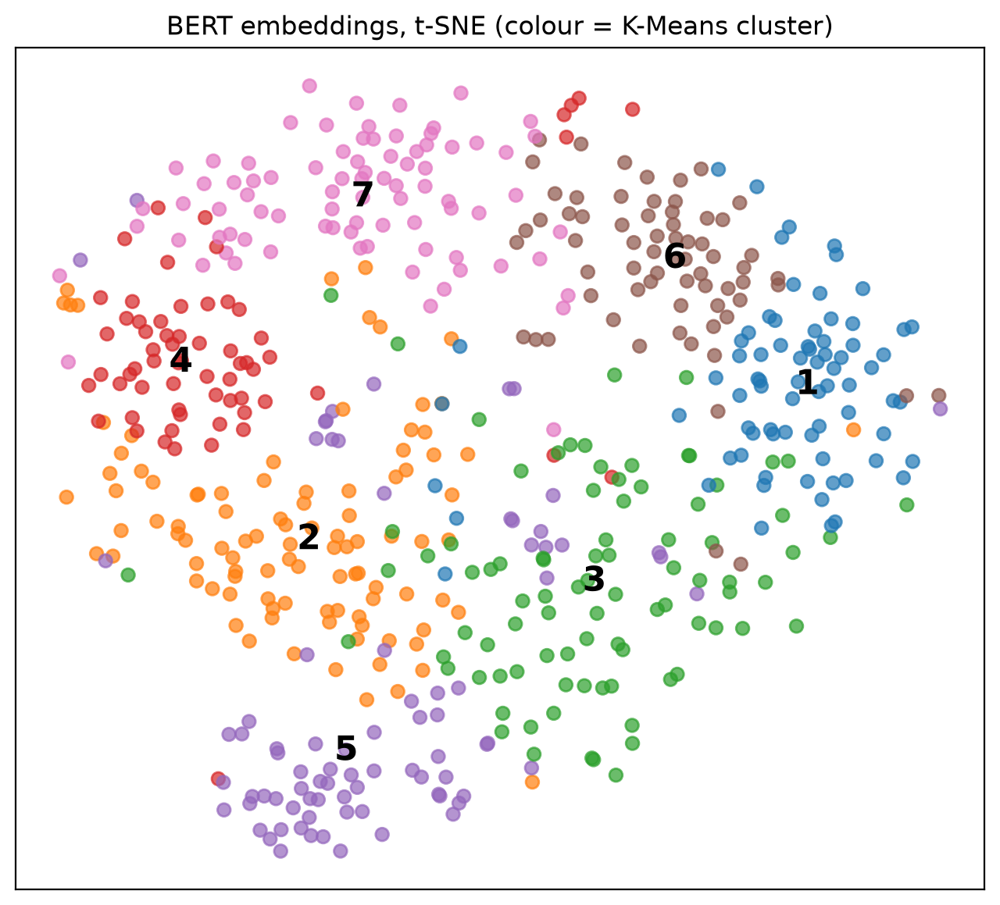
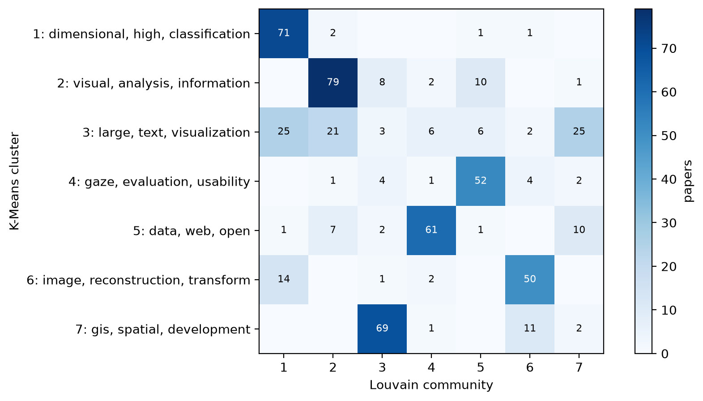
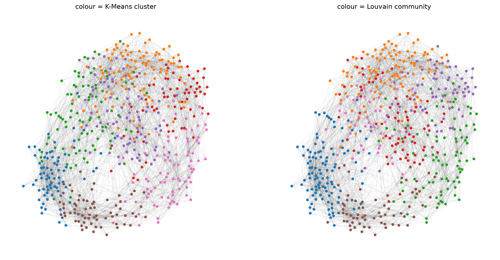

# Week 11: Grouping Documents with BERT Embeddings

**Goal:** split ~560 academic papers into groups that share a topic, describe each group, and show how the papers and groups relate, without reading every abstract.

A computer can't compare paragraphs of text directly. We let a language model, **BERT**, turn every paper into a list of 768 numbers (an **embedding**). Papers about similar things get similar embeddings, so we can measure how close two papers are, group close papers into **clusters**, and link the closest papers into a **network** that you can explore in Gephi.

```
 559 papers ──► BERT ──► 559 × 768 ──► cosine ──► K-Means ──► describe ──► similarity
  (text)               embeddings    similarity   clusters    clusters      network → Gephi
```

| Step | Task | Output |
|---|---|---|
| 1 | Load and clean the data | 559 papers, title + abstract |
| 2 | Embed every paper with BERT | 559 × 768 matrix |
| 3 | Compare papers with cosine similarity | 559 × 559 similarity matrix |
| 4 | Cluster the embeddings with K-Means | a cluster number per paper |
| 5 | Visualize the clusters with PCA and t-SNE | 2D maps |
| 6 | Interpret each cluster | representative titles and words |
| 7 | Build a network of similar papers | `Documents_bert.gexf` for Gephi |

**Files**

- `Week_11_BERT_Embeddings.ipynb`: the notebook that walks through every step below
- `Week_11_BERT_Embeddings.pptx`: the lecture slides
- `embeddings_bert.npy`: the BERT embeddings (559 × 768), created the first time the notebook runs
- `Documents_bert.gexf`: the paper network, created by the notebook, to open in Gephi
- `img/`: snapshots of the notebook's outputs, used in this README

The dataset is `Week-8-ForceSimulator/data/data_scopus.csv` (a Scopus export with title, abstract, year, authors, …). The notebook reads it from the repository, or from GitHub if the local file isn't found.

---

## Setup

```sh
pip install transformers torch scikit-learn networkx pandas matplotlib
```

Open the notebook in Jupyter, VS Code or Colab and run the cells in order. The first run downloads the BERT model (about 440 MB) and computes the embeddings in about half a minute. They are saved in `embeddings_bert.npy`, and later runs load that file instead.

---

## 1. Load and clean the data

The Scopus export has 570 records and 13 columns. We use three of them: `Title`, `Abstract` and `Year`.

### Remove records that are not papers

Eleven records are not research papers:

- 8 whole conference volumes ("Proceedings of the 1998 IEEE Visualization Conference", …), whose abstract is a table of contents
- 2 records without an abstract and 1 without a title

BERT reads *how* a text is written as well as *what* it is about, so these records would form a group of their own because of their style. After removing them, **559 papers** remain.

### Remove publisher notices

371 of the 559 abstracts end with a copyright line:

```
… for the built environment. © 2020 Elsevier B.V.     →     … for the built environment.
```

These words describe the publisher, not the topic. A regular expression cuts everything from the notice to the end of the abstract:

```python
pattern = r'\s*(Crown Copyright|Copyright \d{4}|Copyright ©|©).*$'
clean_abstracts = df_papers['Abstract'].str.replace(pattern, '', regex=True)
texts = (df_papers['Title'] + '. ' + clean_abstracts).tolist()     # one text per paper
```

---

## 2. BERT embeddings

**BERT** (`bert-base-uncased`) is a language model with 12 transformer layers. It reads a text and produces one 768-number vector for every **token** (word or word piece). Thanks to **attention**, every token looks at every other token, so the vector for "reality" in "virtual reality" is different from "reality" on its own.

```python
tokenizer = AutoTokenizer.from_pretrained('bert-base-uncased')
model = AutoModel.from_pretrained('bert-base-uncased')

tokenizer("Virtual reality for museum visits")
# ['[CLS]', 'virtual', 'reality', 'for', 'museum', 'visits', '[SEP]']
```

`[CLS]` and `[SEP]` mark the start and end of the text. BERT reads at most 512 tokens; longer texts are cut.

### One vector per paper: mean pooling

To get **one vector per paper**, we average the token vectors (**mean pooling**):

```
"Virtual reality for museum visits ..."
   │ tokenizer
   ▼
[CLS] virtual reality for museum visits ... [SEP]
   │ BERT (12 layers)
   ▼
one 768-number vector per token  ──► average ──► one 768-number vector per paper
```

The notebook embeds the papers in batches of 16. Texts in a batch have different lengths, so the shorter ones are filled with `[PAD]` tokens. The **attention mask** (1 = real token, 0 = padding) keeps the padding out of the average:

```
paper 1:  [CLS] virtual reality museum visits [SEP]     mask: 1 1 1 1 1 1   → average of 6 tokens
paper 2:  [CLS] image   filter  [SEP] [PAD]  [PAD]      mask: 1 1 1 1 0 0   → average of 4 tokens
```

```python
token_vectors = model(**batch).last_hidden_state          # (papers, tokens, 768)
mask = batch['attention_mask'].unsqueeze(-1)              # (papers, tokens, 1)
mean = (token_vectors * mask).sum(dim=1) / mask.sum(dim=1)
```

The result is `embeddings`, a **559 × 768** matrix: one row per paper.

### A first look at the embeddings



Each row of the heatmap is a paper, each column one of the 768 dimensions. Two things stand out:

- **Vertical stripes:** every row looks almost the same. On average, **87%** of a paper's vector is the **average vector** shared by all papers (bottom plot). It encodes something like "academic English text", not the topic of the paper.
- **One extreme dimension:** dimension 308 is about −3.4 for every paper. The values range from −4.4 to 1.2, but 98% of them lie between −0.69 and 0.69, so the colour scale is clipped to that range. Otherwise this one dimension would turn everything else into one colour.

The differences between papers are small compared to what they share. The next section shows why that matters and how to remove it.

---

## 3. Cosine similarity

### Comparing two papers

The **cosine similarity** of two vectors is the cosine of the angle between them:

```
cos(a, b) = (a · b) / (|a| |b|)          1 = same direction,  0 = unrelated,  −1 = opposite
```

It compares the **direction** of the vectors, not their length, so a long and a short abstract about the same topic can still score high. We compute it for every pair of papers, which gives a **559 × 559** matrix.

### Raw BERT: every pair looks similar



The histogram counts the similarity of all ~156,000 pairs of papers. Almost every pair falls between 0.75 and 0.95: a paper on image denoising looks almost as similar to a GIS paper as to another denoising paper. The reason is the shared average vector: when 87% of every vector is the same, all the angles are small.

### Centering: remove what all papers share

The fix is simple. Subtract the **average embedding** from every paper (**centering**), then scale each vector to length 1:

```python
embeddings_centered = embeddings - embeddings.mean(axis=0)
X = embeddings_centered / np.linalg.norm(embeddings_centered, axis=1, keepdims=True)
similarity = cosine_similarity(X)
```

```
 raw: all vectors point the same way          centered: the shared part is removed

        ↗↗↗ ↗↗ ↗                                       ↖ ↖ ↑
       ↗↗↗↗↗ ↗   (cos ≈ 0.9 for every pair)              ●        (groups point in
                                                          ↘ ↘ ↘     different directions)
```

What remains is how each paper **differs** from the average paper, and that difference is what tells topics apart.



Both histograms use the same x axis. After centering, the similarities spread from about −0.4 to 0.6, and most pairs are near 0: most papers are unrelated to most other papers. Only the few pairs above about 0.4 are truly similar, and those are the pairs that clustering and the network use.



The same heatmap after centering: the shared stripes are gone. In file order the rows look like noise; in step 4 we sort them by cluster and the structure appears.

### Does it work? The most similar papers

Before clustering, a quick check: pick a paper and list the papers with the highest similarity.

| Similarity | *DiseaSE: A biomedical text analytics system for disease symptom extraction …* |
|---|---|
| 0.47 | P2CS: A two-component system resource for prokaryotic signal transduction research |
| 0.45 | P2TF: A comprehensive resource for analysis of prokaryotic transcription factors |
| 0.45 | Mining and exploring care pathways from electronic medical records with visual analytics |
| 0.43 | Pathways database system: An integrated set of tools for biological pathways |

| Similarity | *Virtual reality applications for the built environment: Research trends and opportunities* |
|---|---|
| 0.75 | Building information modelling for off-site construction: Review and future directions |
| 0.61 | Brain computer interfaces for mobile apps: State-of-the-art & future directions |
| 0.53 | Modelling user experience: Integrating user experience research into design education |
| 0.53 | Spatialization methods: A cartographic research agenda for non-geographic information visualization |

The first paper's neighbours share its **topic** (biomedical data and tools). The second paper is a review, and its neighbours are other **reviews and research agendas**. BERT captures the *kind* of text as well as its topic. Keep this in mind when you read the clusters in step 6.

---

## 4. Cluster the embeddings

### How many clusters? The silhouette score

K-Means needs the number of clusters *k* before it runs. The **silhouette score** helps choose it. For each paper:

```
a = average distance to the other papers in its own cluster
b = average distance to the papers of the nearest other cluster

s = (b − a) / max(a, b)        1 = clearly in the right cluster,  0 = on a border,  < 0 = probably wrong
```

We run K-Means for k = 2 … 14 and compare the average silhouette:



- All values are low (0.07–0.15): research topics overlap, so there are no sharp borders between groups.
- The score is highest for small k and stays on a plateau up to k = 6, then drops at k = 7.
- But at k = 6, image processing and machine learning still fall into one cluster. k = 7 separates them, and every cluster becomes a recognizable topic.

The plot gives a **range**; whether the clusters can be **named** decides within it. We use **k = 7**. In step 7, a method that chooses the number of groups by itself also finds 7.

### K-Means

K-Means places *k* centres, assigns each paper to the nearest centre, moves each centre to the mean of its papers, and repeats until nothing changes:

```python
kmeans = KMeans(n_clusters=7, random_state=SEED, n_init=10)
labels = kmeans.fit_predict(X) + 1      # clusters numbered 1 … 7
```

- `n_init=10` runs K-Means from 10 different starting centres and keeps the best result.
- `random_state=SEED` makes the result the same on every run.
- The clusters have between 64 and 100 papers.

### The embeddings again, sorted by cluster



This is the noisy heatmap from step 3, with the papers sorted by cluster and lines between the clusters.

- **Left:** the centered embeddings, with columns grouped by the cluster in which they are highest. Each cluster has its own band of high (red) and low (blue) dimensions.
- **Right:** the cosine similarity matrix in the same order. The bright **blocks along the diagonal** show that papers in the same cluster are similar to each other. The bright block between clusters 1 and 6 shows that the dimensionality-reduction and image-processing papers are related.

This figure is the clearest evidence that the clusters are real.

---

## 5. Visualize the clusters

We cluster in all 768 dimensions. To **look** at the result, we project the papers to 2D and colour them by cluster.

### PCA

**PCA** finds the direction in which the papers spread the most (PC1), then the largest spread at a right angle to it (PC2), and projects every paper onto these two directions. It is a straight-line view of the data.



Several clusters occupy their own region: 1 (dimensionality reduction) on the right, 2 (visual analytics) on the left, 7 (GIS) at the bottom, 6 (image processing) at the bottom right. Clusters 3, 4 and 5 overlap in the middle. The two components show only **19%** of the variance, so overlap in this picture does not mean that the clusters overlap in 768 dimensions.

### t-SNE

**t-SNE** is a non-linear map: it tries to keep every paper's **nearest neighbours** close together in 2D. `perplexity=30` sets roughly how many neighbours each paper "cares about", and `metric='cosine'` uses the same similarity as the rest of the notebook.



The clusters separate much better than with PCA: most of them form their own region, for example 7 (GIS) at the top left, 1 (dimensionality reduction) on the right and 5 (web data platforms) at the bottom. Neighbouring papers usually share a cluster, which supports the clustering.

On a t-SNE map, only the neighbourhoods are meaningful. The **distances between** regions and the **sizes** of the regions are not.

---

## 6. Interpret the clusters

The 768 numbers have no names, so we describe each cluster with its papers:

- **Representative titles:** the papers closest to the cluster centre (highest cosine similarity with the average vector of the cluster).
- **Typical title words:** words that are frequent in this cluster's titles **and** more frequent there than in all titles:

```
score(word) = count in cluster × log( share of the cluster's titles with the word
                                     / share of all titles with the word )
```

| # | Papers | Typical title words | Most representative title |
|---|---|---|---|
| 1 | 75 | dimensional, classification, reduction | Self-organizing maps with information theoretic learning |
| 2 | 100 | visual, analysis, information, analytics | Multi-faceted insight through interoperable visual information analysis paradigms |
| 3 | 88 | large, text, visualizing, technique | Navigating hierarchies with structure-based brushes |
| 4 | 64 | gaze, evaluation, usability, users | Investigating elearning preferences of adults with intellectual disability |
| 5 | 82 | data, web, open, water, ontology | HydroDesktop: Web services-based software for hydrologic data discovery … |
| 6 | 67 | image, reconstruction, transform | Choice of the regularization parameter for total variation image denoising … |
| 7 | 83 | gis, spatial, development, management | Technological developments for environmental studies |

These are the topics of the collection: dimensionality reduction and machine learning, visual-analytics theory (including the review papers from step 3), visualization techniques for text and hierarchies, user studies, web-based data platforms (many about water and hydrology), image processing, and GIS.

---

## 7. Similarity network and communities

Clusters put every paper in exactly one box. A **network** shows more: which papers are closest to each other, which papers bridge two topics, and a second, independent way to find groups.

### Nearest-neighbour graph

Each paper becomes a **node**, linked to its **10 most similar papers**:

```python
sim = similarity.copy()
np.fill_diagonal(sim, -1)                                   # a paper is not its own neighbour
neighbors = np.argsort(-sim, axis=1)[:, :10]
for i in range(len(df_papers)):
    for j in neighbors[i]:
        G.add_edge(i, j, weight=sim[i, j])
```

With one global similarity threshold instead, papers in dense topics would get dozens of links and papers in small topics none. Linking every paper to its nearest neighbours keeps every paper connected. The graph has **559 nodes and 4,093 edges** in one connected piece (fewer than 5,590 edges, because when A and B are each other's neighbours, the link counts once).

### Louvain communities

The **Louvain** algorithm finds **communities**: groups of nodes with many links inside and few links between them. Unlike K-Means, it chooses the number of groups by itself.

- **Modularity** measures how well the communities separate: above ~0.3 means a clear structure.
- The **adjusted Rand index (ARI)** compares two groupings: 1 = identical, 0 = no better than random.

| Result | Value |
|---|---|
| Communities | **7** (the same number as our clusters) |
| Modularity | 0.60 |
| ARI, communities vs clusters | 0.51 |



Each number counts papers that are in a given cluster (row) and community (column). Six of the seven clusters map almost one-to-one onto a community, for example cluster 1 onto community 1 (71 papers). Cluster 3 (visualization techniques for text and hierarchies) is split over three communities, so it is the least coherent topic. Cluster 6 (image processing) sends 14 papers to the community of cluster 1, matching the related blocks in the sorted similarity matrix.

### The paper network



Both panels show the same graph with the same layout: linked papers are pulled together. On the left the colour is the K-Means cluster, on the right the Louvain community. The colour numbers of the two panels do not correspond, so compare **regions**, not colours. For example, the dimensionality-reduction papers form the same dense region on the left side in both panels.

### Exploring it in Gephi

```python
nx.write_gexf(G, "Documents_bert.gexf")
```

**GEXF** is the graph format of [Gephi](https://gephi.org/). Every node has the attributes `title`, `year`, `cluster`, `cluster_name` and `community`. In Gephi:

1. Open `Documents_bert.gexf` as an undirected graph.
2. **Layout:** run *ForceAtlas 2* until the layout settles.
3. **Appearance → Nodes → Color → Partition:** choose `cluster_name` or `community`.
4. **Appearance → Nodes → Size → Ranking:** choose *Degree*, so well-connected papers are bigger.
5. Turn on node labels and choose `title` to see which papers sit where.

---

## Try it yourself

1. Skip the centering step and cluster the raw embeddings. What happens to the silhouette scores and to the cluster descriptions?
2. Set `n_clusters` to 5 and to 10. Which cluster descriptions become clearer, and which more confusing?
3. Call `most_similar()` for other papers. When do the neighbours share the topic, and when only the kind of text?
4. Build the graph with 5 and with 20 neighbours. How many Louvain communities do you get?
5. In Gephi, colour the nodes by `year`. Do the topics change over time?
6. Export the graph as JSON (`nx.node_link_data(G)`) and draw it with a D3 force simulation, as in Week 8.
