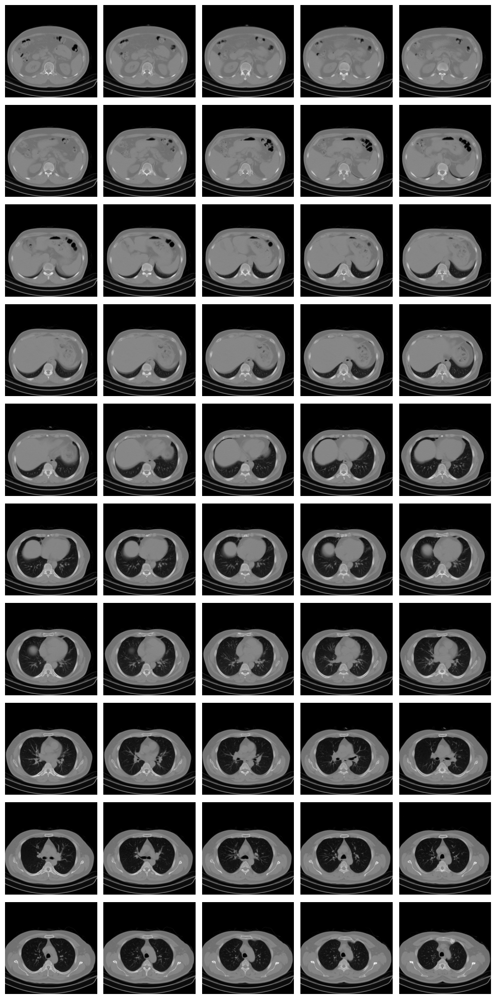
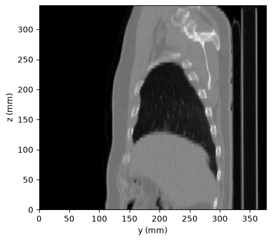
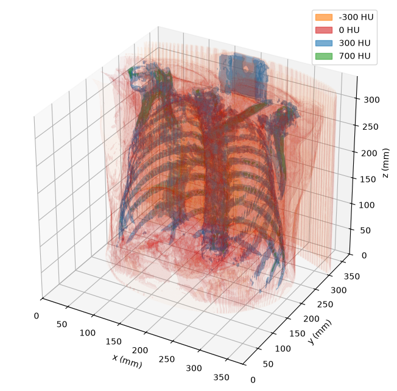

# Week 11: Medical Imaging Data (DICOM) — From Slices to a 3D Surface

This example turns a stack of CT scan images into a 3D model. You will read raw medical image files, clean and assemble them into one 3D array, look at the body from different directions, and extract 3D surfaces such as the skin and the skeleton.

**Files**

- `dicom_processor.ipynb`: the notebook that walks through every step below
- `DICOM_data/`: 68 CT slices of a chest scan (`01.dcm` … `68.dcm`)
- `images/`: snapshots of the notebook's outputs, used in this README
- `isoSurface.obj`: created when you run the notebook (the 3D bone surface)

---

## Setup

```sh
pip install pydicom scikit-image scipy matplotlib numpy pandas ipympl
```

Open `dicom_processor.ipynb` in Jupyter or VS Code and run the cells in order. `%matplotlib widget` (from `ipympl`) lets you rotate the 3D plot with the mouse. If it does not work in your environment, change that cell to `%matplotlib inline`.

---

## 1. What is a DICOM file?

**DICOM** (Digital Imaging and Communications in Medicine) is the standard file format for medical images. CT and MRI scanners save **one file per slice**: each file is a single 2D cross-section of the body.

Each `.dcm` file has two parts:

| Part | What it contains |
|---|---|
| **Header** (metadata) | Hundreds of tagged fields: scanner, image size, pixel size, slice position, how to convert pixel values, … |
| **Pixel data** | The 2D image itself, as a grid of integers |

Each header field has a numeric tag such as `(0028, 0030)` and a readable name such as `PixelSpacing`. `pydicom` lets you access the fields by name:

```python
ds = pydicom.dcmread('DICOM_data/01.dcm')
ds.Rows, ds.Columns      # 512, 512
ds.PixelSpacing          # [0.736, 0.736]  (mm per pixel)
ds.pixel_array           # 512 x 512 NumPy array
```

The header fields used in this notebook, with their values for our dataset:

| Field | Value here | Meaning |
|---|---|---|
| `Rows`, `Columns` | 512, 512 | Image size in pixels |
| `PixelSpacing` | 0.736 mm × 0.736 mm | Physical size of one pixel |
| `SliceThickness` | 5.0 mm | Thickness of each slice |
| `ImagePositionPatient` | `[x, y, z]` in mm | Where the slice is in the patient's body. **`z` is the slice height.** |
| `RescaleSlope`, `RescaleIntercept` | 1.0, −1024 | How to convert stored values to Hounsfield Units |
| `SeriesInstanceUID` | (long ID) | Identifies which scan the slice belongs to |
| `InstanceNumber` | 1 … 68 | Slice number assigned by the scanner |

> **Privacy note:** DICOM headers can contain personal information (name, birth date, hospital IDs). Real medical data must be **de-identified** before it is shared or published. Treat any DICOM file you find with care.

---

## 2. The pipeline step by step

### Step 1: Find the files

```python
files = sorted(glob.glob('./DICOM_data/*.dcm'))
```

`glob` returns files in **arbitrary order**, so we always sort the list. The files are named with zero padding (`01`, `02`, …, `10`). Without it, `"10.dcm"` would sort before `"2.dcm"`.

### Step 2: Read every file

```python
dicom_datasets = [pydicom.dcmread(file) for file in files]
```

`dcmread` returns a `Dataset` object holding both the header and the pixel data.

### Step 3: Sanity checks and slice ordering (data cleaning)

Before stacking the slices, we check that they actually belong together:

1. **Same series:** every file has the same `SeriesInstanceUID`. Scanners often save several scans, such as a scout image or a second contrast phase, in the same folder. Mixing them gives a broken volume.
2. **Same image size:** every slice has the same `Rows × Columns`. Slices of different sizes cannot be stacked into one array.
3. **Sort by physical position:** file names and `InstanceNumber` are only labels. The reliable ordering is the slice's **height in the body**, `ImagePositionPatient[2]`:

   ```python
   dicom_datasets.sort(key=lambda ds: float(ds.ImagePositionPatient[2]))
   ```

   In this dataset the file numbers actually count **downward**: `01.dcm` is at z = 676.5 mm (near the shoulders) and `68.dcm` is at z = 341.5 mm (the upper abdomen). If you trusted the file names, the body would appear upside down. Sorting by increasing z puts slice 0 at the bottom and the last slice at the top.
4. **No missing slices:** the gaps between consecutive z values should all be equal (5 mm here). A larger gap means a slice is missing.

### Step 4: Assemble the slices into one 3D array

Each slice is a 2D array of shape `(512, 512)`. We create an empty 3D array and fill it one slice at a time:

```python
ct_scan = np.zeros((len(dicom_datasets), rows, columns), dtype=np.float32)
for i, ds in enumerate(dicom_datasets):
    ct_scan[i, :, :] = ds.pixel_array * float(ds.RescaleSlope) + float(ds.RescaleIntercept)
```

```
   files (sorted by z)            3D NumPy array  ct_scan[z, y, x]

   slice 67 (top)    ┌───────┐         ┌───────┐
   ...               │       │   ──►  ┌┴──────┐│   shape = (68, 512, 512)
   slice 1           │       │       ┌┴──────┐││          (z,   y,   x)
   slice 0 (bottom)  └───────┘       │       │┘┘
                      512×512        └───────┘
```

The array axes are **`[z, y, x]`**: slice index, row and column. Indexing the array in different ways gives the three standard medical views:

| Code | View | Looks at the body from |
|---|---|---|
| `ct_scan[k, :, :]` | **Axial** | Above/below (the original slices) |
| `ct_scan[:, :, c]` | **Sagittal** | The side |
| `ct_scan[:, r, :]` | **Coronal** | The front |

The notebook shows 50 axial slices in a grid, then a sagittal "side view" made by taking the same column from every slice.

**Axial slices** `ct_scan[k, :, :]`: the first 50 slices, read left to right and top to bottom, moving up the body from the upper abdomen (liver, kidneys, bowel gas) through the heart to the upper chest. The curved lines under the body are the scanner table.



**Sagittal side view** `ct_scan[:, :, 100]`: the same image column taken from every slice and stacked. You can see the lungs (black), the diaphragm and liver below them, the spine on the right (the patient's back), and the shoulder bones at the top. The vertical lines on the far right are the table.



### Step 5: Convert to Hounsfield Units (HU)

The stored pixel values are raw scanner numbers (here 0 … 4095). The header says how to turn them into **Hounsfield Units**, the physical CT scale that measures how strongly each tissue absorbs X-rays:

```
HU = raw_value × RescaleSlope + RescaleIntercept
   = raw_value × 1            − 1024        (for this dataset)
```

| Tissue | Approximate HU |
|---|---|
| Air | −1000 |
| Lung | −900 to −500 |
| Fat | −100 to −50 |
| Water | 0 |
| Soft tissue / muscle | +20 to +80 |
| Bone | +300 to +1900 |

Always convert to HU before choosing thresholds. Otherwise a threshold of "1000" means −24 HU (water), not bone. We store the result as `float32`, so values are never truncated.

### Step 6: Respect the real voxel size

A **voxel** is a 3D pixel. Here the voxels are **not cubes**:

```
voxel = 5.0 mm (z)  ×  0.736 mm (y)  ×  0.736 mm (x)
```

Each slice is about 6.8× thicker than a pixel is wide. If you plot the array as if every voxel were a cube, the body looks squashed to about 1/7 of its height. The notebook builds a `voxel_spacing` tuple from the header. It uses it to:

- set the `extent` of the side view in millimetres, which gives correct proportions,
- pass `spacing=` to marching cubes, so the 3D mesh is measured in millimetres.

### Step 7: Downsample

Building a 3D surface from 68 × 512 × 512 ≈ 18 million voxels is slow, so we shrink each slice by a factor of 3 with `scipy.ndimage.zoom`:

```python
downsized_ct_scan = zoom(ct_scan, (1, 1/3, 1/3))   # keep all slices, shrink x and y
```

We **don't** shrink along z: there are only 68 slices, and they are already 5 mm apart. Because each new pixel covers 3 old ones, the in-plane spacing becomes `0.736 × 3 ≈ 2.2 mm`.

### Step 8: Extract iso-surfaces with Marching Cubes

An **iso-surface** is the 3D version of a contour line: the surface where the data crosses one particular value (the *iso-value*). The **Marching Cubes** algorithm finds it:

1. It looks at each small cube formed by 8 neighbouring voxels.
2. If some corners are above the iso-value and some are below, the surface passes through that cube.
3. It places triangles inside the cube where the surface crosses, using a lookup table.
4. Together, all the triangles form a mesh.

```python
verts, faces, normals, values = measure.marching_cubes(volume, level=300, spacing=downsized_spacing)
```

- `verts`: an `(N, 3)` array of vertex positions (in mm, in `(z, y, x)` order)
- `faces`: an `(M, 3)` array; each row holds the indices of the 3 vertices of one triangle

Different iso-values reveal different tissues:

| Iso-value | Shows |
|---|---|
| −300 HU | Skin (the boundary between air and body) |
| 0 HU | Soft tissue and organs |
| 300 HU | Bone (ribs, spine, shoulders) |
| 700 HU | Dense bone only |

The notebook draws all four surfaces in one 3D plot. The outer surfaces are drawn more transparent so you can see the skeleton inside. Because marching cubes returns `(z, y, x)`, we reverse each vertex to `(x, y, z)` before plotting so that z points up.



The rib cage, spine, collarbones and shoulder blades are clearly visible inside the faint skin and soft-tissue surfaces. The rectangular block at the top right, behind the body, is part of the scanner table.

### Step 9: Export the mesh to an OBJ file

**OBJ** is a simple, widely supported text format for 3D meshes:

```
v 12.5 140.2 88.0      ← a vertex (x y z)
v ...
f 1 2 3                ← a triangle made of vertices 1, 2, 3
```

OBJ vertex numbers start at **1**, while Python starts at **0**, so we add 1 to each face index. You can open `isoSurface.obj` in Blender, macOS Preview/Quick Look, Windows 3D Viewer, or load it in a web page with three.js.

---
