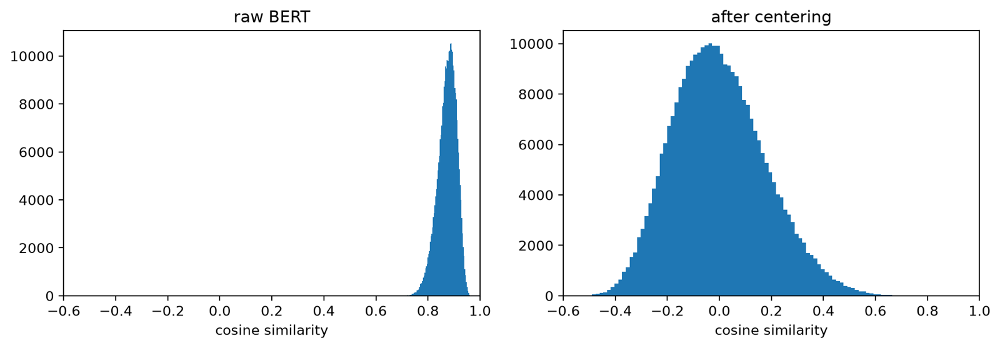
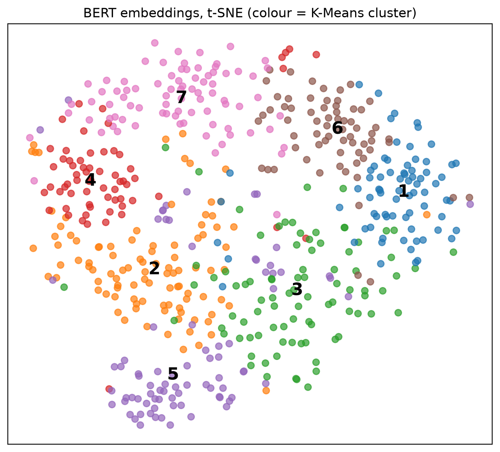
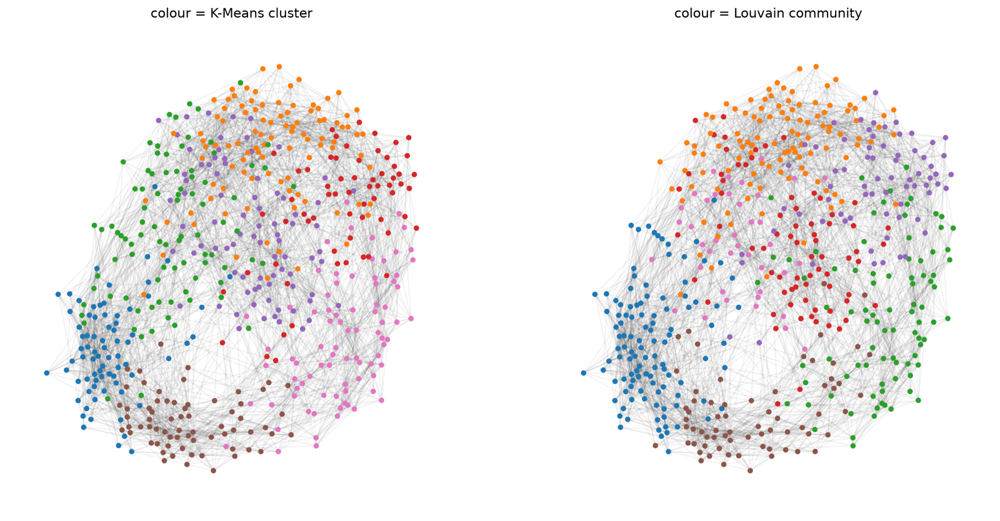
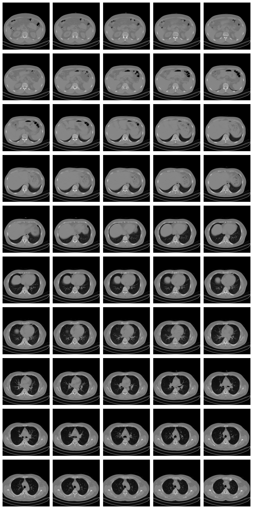
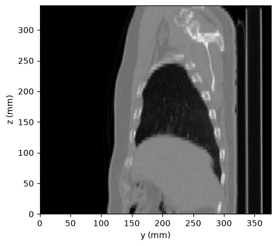
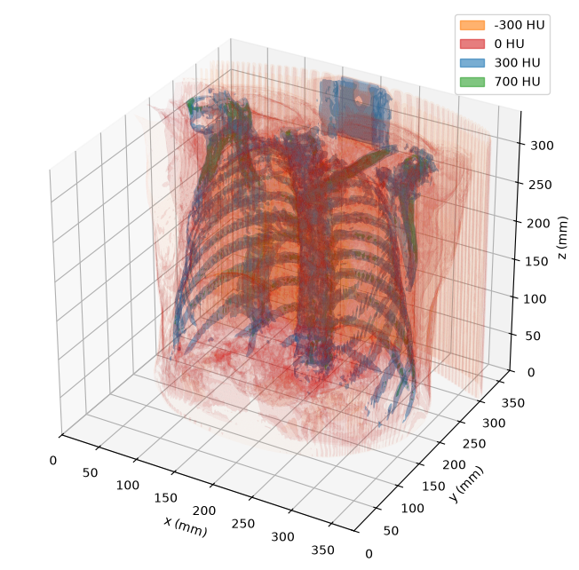

# Week 11: Data Reduction & Medical Imaging

This week has two parts. **Part 1** reduces high-dimensional data (tables and text) into something we can draw: similarity networks and 2D maps. **Part 2** turns a stack of CT scan images into a 3D model.

Each project has its own README or notebook with the full walkthrough. This page is an overview.

| Folder | Topic | Tools |
|---|---|---|
| [`ML-Data-Reduction/OneHotEncoding`](ML-Data-Reduction/OneHotEncoding/) | From table to network (IMDB movies) | Python, D3 |
| [`ML-Data-Reduction/PCS-Bert-CosineSimilarity`](ML-Data-Reduction/PCS-Bert-CosineSimilarity/) | Grouping documents with BERT embeddings | Python, Gephi |
| [`Medical-Data-DICOM`](Medical-Data-DICOM/) | Medical imaging: from slices to a 3D surface | Python |

---

## Part 1: ML & Data Reduction

### 1.1 One-Hot Encoding: From Table to Network

[`ML-Data-Reduction/OneHotEncoding/`](ML-Data-Reduction/OneHotEncoding/)

The IMDB Top 1000 table becomes a network of related movies.

- **Python side** ([`PythonCode/HotBit_-_Encoding.ipynb`](ML-Data-Reduction/OneHotEncoding/PythonCode/HotBit_-_Encoding.ipynb)): one-hot encode the categorical columns, compare movies with cosine similarity, keep pairs above a threshold, and export `output.json`.
- **D3 side** (`index.html` + `network.js`): a force layout of the network, with a toggle to show movie posters.

Run it with a local server (it loads `output.json`).

### 1.2 Grouping Documents with BERT Embeddings

[`ML-Data-Reduction/PCS-Bert-CosineSimilarity/`](ML-Data-Reduction/PCS-Bert-CosineSimilarity/) · [README](ML-Data-Reduction/PCS-Bert-CosineSimilarity/README.md)

About 560 academic papers are embedded with BERT, compared with cosine similarity, clustered with K-Means, mapped to 2D with PCA and t-SNE, and linked into a similarity network for Gephi.

---

## Part 2: Medical Imaging Data (DICOM)

[`Medical-Data-DICOM/`](Medical-Data-DICOM/) · [README](Medical-Data-DICOM/README.md)

Read 68 CT slices (DICOM files), assemble them into a 3D volume, view it from different directions, and extract 3D surfaces such as the skin and the skeleton.

