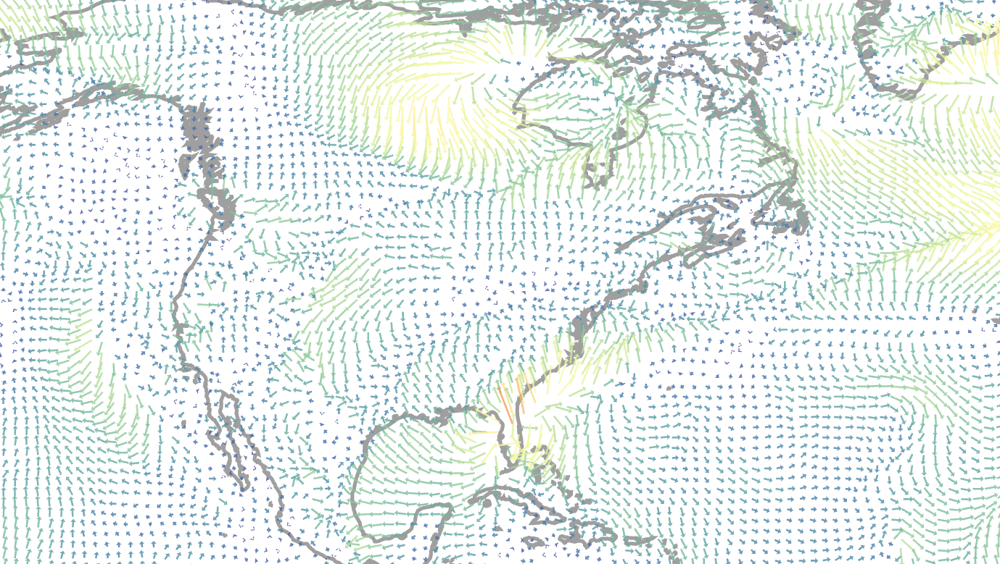
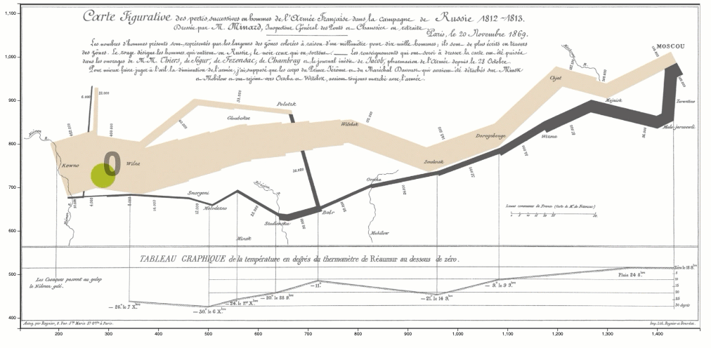
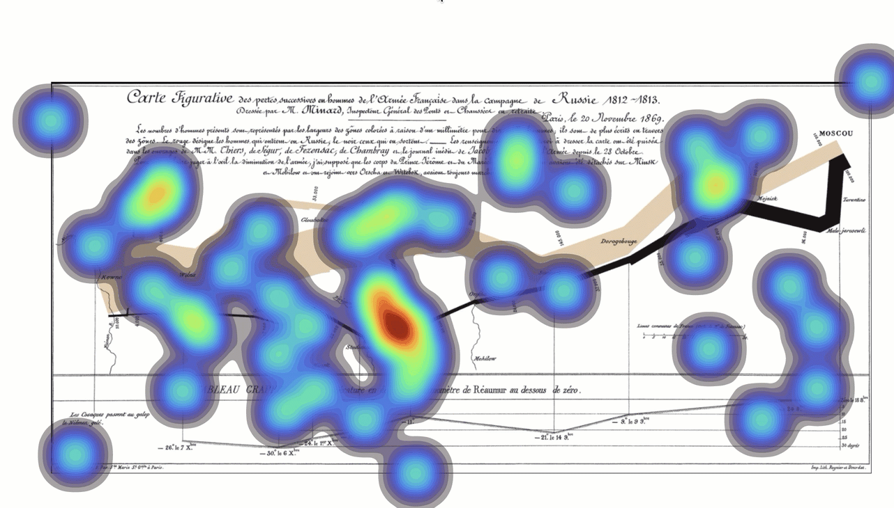

# Week 12: Glyphs, Eye Tracking & Linked Tooltips

This week has three parts. **Part 1** draws wind data with glyphs: small shapes whose direction, length and color
encode several values at once. **Part 2** visualizes eye-tracking data as a scan path and a heat map. **Part 3** links
a zoomable election map to a tooltip that draws its own chart, and adds a manipulable view of CT scan contours.

Each part has its own README with the full walkthrough. This page is an overview.

| Folder | Topic | Tools |
|---|---|---|
| [`Week-12-Zoom_Glyphs`](Week-12-Zoom_Glyphs/) | Wind field visualization with glyphs | D3, TopoJSON, Canvas |
| [`Week-12-Eyetracking`](Week-12-Eyetracking/) | Scan paths and heat maps of eye fixations | D3, Python |
| [`Week-12-Part-2 MultiView Tooltip`](Week-12-Part-2%20MultiView%20Tooltip/) | US election map with a chart inside the tooltip, and CT scan contours | D3, TopoJSON |

Run every example with a local server, since they all load data files.

---

## Part 1: Zoom and Glyphs

[`Week-12-Zoom_Glyphs/`](Week-12-Zoom_Glyphs/) · [README](Week-12-Zoom_Glyphs/README.md)

All examples use the same global grid of wind and temperature values (`data/windData.json`).

1. **Field data** ([`Example_01_FieldData`](Week-12-Zoom_Glyphs/Example_01_FieldData/)): the temperature of each
   grid cell drawn as a colored rectangle.
2. **Making a glyph** ([`Example_02_MakingGlyph`](Week-12-Zoom_Glyphs/Example_02_MakingGlyph/)): an arrow built with
   a D3 path, with a function that sets its direction, length, scale and color from the wind data.
3. **Using the glyph** ([`Example_03_UseGlyph`](Week-12-Zoom_Glyphs/Example_03_UseGlyph/)): one glyph per grid cell,
   first on its own and then on a base map.
4. **Animated glyphs** ([`Example_04_AnimatedGlyph`](Week-12-Zoom_Glyphs/Example_04_AnimatedGlyph/)): the wind
   glyphs on a grid, on a base map, and animated.
5. **A real-world wind map** ([`Example_05_AnimatedGlyph_RealWorld`](Week-12-Zoom_Glyphs/Example_05_AnimatedGlyph_RealWorld/)):
   the global wind field drawn on a canvas, with a color bar.

---

## Part 2: Eye Tracking

[`Week-12-Eyetracking/`](Week-12-Eyetracking/) · [README](Week-12-Eyetracking/README.md)

Fixations recorded while a person looked at a stimulus image (`data/stimuli.png`).

1. **Scan path** ([`Example_01_ScanPath`](Week-12-Eyetracking/Example_01_ScanPath/)): fixations as circles and
   saccades as lines, drawn over the stimulus.
2. **Heat map** ([`Example_02_HeatMap`](Week-12-Eyetracking/Example_02_HeatMap/)): fixation density computed with
   `d3.contourDensity`.

The notebook in [`EyeTribe_dataProcessing/`](Week-12-Eyetracking/EyeTribe_dataProcessing/dataProcess.ipynb) turns the
raw EyeTribe tracker output into the fixations file.

---

## Part 3: Multiview Tooltip

[`Week-12-Part-2 MultiView Tooltip/`](Week-12-Part-2%20MultiView%20Tooltip/) · [README](Week-12-Part-2%20MultiView%20Tooltip/README.MD)

A zoomable map of US counties colored by presidential election results (2008–2020) with a diverging color scale and a
legend. Hovering over a county opens a tooltip that draws a small line chart of that county's results.

### Example: CT Scan Contours

[`Example_CT_Contours/`](Week-12-Part-2%20MultiView%20Tooltip/Example_CT_Contours/) · [README](Week-12-Part-2%20MultiView%20Tooltip/Example_CT_Contours/readme.md)

A manipulable view of 20 brain CT slices drawn as filled contours with `d3.contours`. Pick a slice, then use the
sliders to set the number of contour levels and the range of values they cover.
