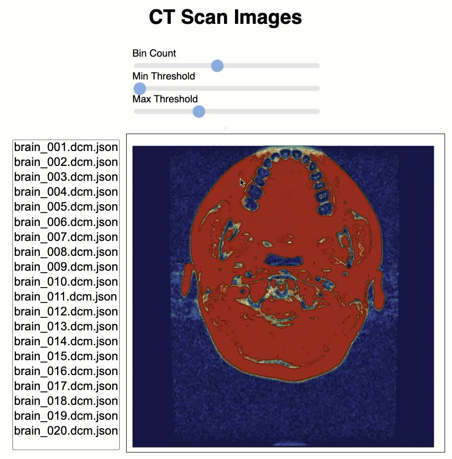

# Example: Contours of CT Scan Slices

A manipulable view of 20 slices of a brain CT scan. Each slice is a 256 × 256 grid of pixel values, drawn as filled
contours with `d3.contours`. Pick a slice from the list, and use the sliders to change how the contours are computed.

## What you can change

| Control | What it does |
| --- | --- |
| Slice list | Loads another slice from `dicomData/` (data modification) |
| Bin Count | The number of contour levels between the min and max thresholds (derived feature modification) |
| Min / Max Threshold | The range of pixel values that gets contours and colors (channel modification) |

## How the code works

1. **Load a slice.** `d3.json` reads a 256 × 256 array, and `data.flat()` turns it into the 1D list that
   `d3.contours` expects.
2. **Fit the sliders.** The min and max threshold sliders are set to the value range of the slice (`d3.extent`).
3. **Compute the contours.** `Bin Count` thresholds are spaced evenly between the two threshold sliders, and
   `d3.contours().size([256, 256]).thresholds(thresholds)` turns the values into one polygon per threshold.
4. **Color them.** A `d3.scaleLinear` spreads seven colors evenly between the min and max thresholds and blends them
   with `d3.interpolateHcl`.
5. **Draw.** `d3.geoPath()` with no projection draws each contour polygon as an SVG path.

Run it with a local server, since it loads the slices with `d3.json`.
