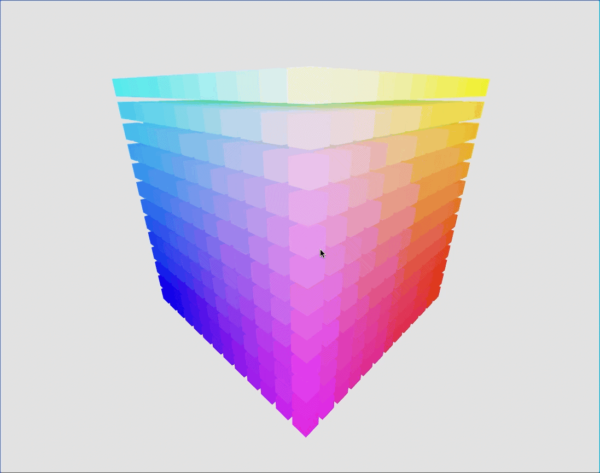

# Example 02 - RGB Color Cubes

In Example 01, you learnt how to set up the scene, add a camera, and add items. In this example we will
use the same tools to make the following visualization:



Run it through a local server (Live Server or `python3 -m http.server`), as described in the
[main README](../README.md#how-to-run-the-examples).

## The code in `js/MyThreeJS.v001.js`

### 1. `myThreeJSV001()`

To simplify the use of ThreeJS, I have made this function that contains all the repeated code for
each ThreeJS based visualization. In every ThreeJS visualization, a scene, camera, renderer and controls are needed.

The function takes no parameters. It starts by creating the scene and the camera and setting the camera's position:

```js
    const spaceColor="#e5e5e5"
    const scene = new THREE.Scene();
    const camera = new THREE.PerspectiveCamera(75,window.innerWidth/window.innerHeight,0.1,1000);
    camera.position.z = 10;
```

Then it creates the renderer and, using `THREE.OrbitControls`, a controller instance that lets you rotate, zoom and pan with the mouse.

```js
    const controls = new THREE.OrbitControls( camera, renderer.domElement );
    controls.enableZoom = true;
```

Finally, the function returns the needed instances.

#### The function returns

- **`scene`**: The main Three.js `Scene` object.
- **`camera`**: A `PerspectiveCamera` configured with:
  - Field of view: 75 degrees
  - Aspect ratio: Matches the browser window
  - Near and far clipping planes: 0.1 and 1000
  - Default position: `z = 10`
- **`renderer`**: A `WebGLRenderer` with:
  - Antialiasing enabled
  - Background color set to `#e5e5e5`
  - Responsive resizing based on window size
- **`controls`**: Orbit controls for interactive camera rotation and zoom.

### 2. `cube(scene, color, x, y, z, width, height, depth)`

`cube` is our own helper function, also in `js/MyThreeJS.v001.js` (it is not part of ThreeJS).
It creates a `BoxGeometry` with a `MeshBasicMaterial` of the given color, places it at `(x, y, z)`,
and adds it to the scene. `width`, `height` and `depth` are optional and default to `0.3`.

### 3. Usage example in the `index.html` file

Using the function `myThreeJSV001()` the instances needed are created, and then the `cube`
function adds the cubes to the specified positions. The d3 function `d3.rgb` is used to create the colors:
the x, y and z positions become the red, green and blue values of each cube.

The cube function receives: `cube(scene instance, color, x, y, z)`.

```javascript
        let tools = myThreeJSV001()
        let scene = tools[0];
        let camera = tools[1];
        let renderer = tools[2];

          for(let i= 0; i<=5 ; i+=.40){
                for(let j= 0; j<=5 ; j+=.40){
                    for(let k= 0; k<=5 ; k+=.40){
                        cube(scene,d3.rgb(parseInt(i*50),parseInt(j*50),parseInt(k*50)).hex(),i,j,k)
                    }}}

    render();
```

### 4. `render()`

After the cubes are added to the scene, `render()` (also in `js/MyThreeJS.v001.js`) draws the scene
with the renderer on every animation frame, using `requestAnimationFrame`.

**Important:** `render()` does not receive the scene, camera and renderer as parameters. It reads
global variables that must be named exactly `scene`, `camera` and `renderer`. That is why
`index.html` stores the returned values in variables with those names. If you rename any of them,
`render()` stops working.
