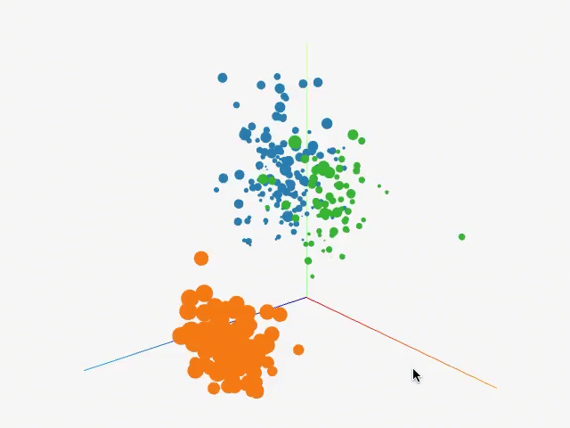

# Example 03 - 3D Scatterplot Without Shading

This example plots the Palmer penguins data (`data/palmer_penguin_species.tsv`) as a 3D scatterplot.
It uses the same strategy as Example 02: a function prepares the scene, camera, renderer and controls,
and a helper function (`point`) adds one sphere per penguin.

Run it through a local server (Live Server or `python3 -m http.server`), as described in the
[main README](../README.md#how-to-run-the-examples). The data is loaded with `d3.tsv`, which does
not work when the file is opened directly from disk.

## Encodings

| Visual channel | Data |
|---|---|
| x (red axis) | culmen length (mm) |
| y (green axis) | culmen depth (mm) |
| z (blue axis) | flipper length (mm) |
| sphere size | body mass (g) |
| color | species |

- Each axis is mapped to the range 0–10 with `d3.scaleLinear`.
- Sphere radius uses `d3.scaleSqrt().domain([0, max])`. The domain starts at 0, so a sphere's area is
  proportional to body mass.
- Axis labels are drawn in the 3D scene as text sprites, and the species legend is an HTML overlay.
- `controls.target` is set to `(5, 5, 5)`, the center of the data, so the view rotates around the data
  instead of around the origin.

## No shading

The spheres use `MeshBasicMaterial`, which ignores lights, so each sphere is drawn as a flat color and
no light is added to the scene. Example 04 adds lights and a shaded material.
