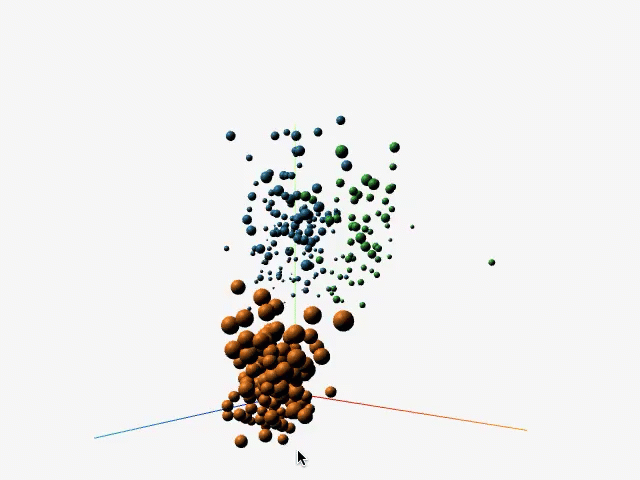

# Example 04 - 3D Scatterplot With Lighting and Shaded Material

This example is the same scatterplot as Example 03 (same data, axes, size and color encodings), with
lighting added so the spheres look three-dimensional.

Run it through a local server (Live Server or `python3 -m http.server`), as described in the
[main README](../README.md#how-to-run-the-examples).

## What changed from Example 03

- **Material:** the spheres use `MeshPhongMaterial` instead of `MeshBasicMaterial`. Phong material
  reacts to lights, which creates shading and highlights.
- **Point light:** `new THREE.PointLight(0xffffff, 0.8)` placed at `(-10, 50, 40)`, above and in front
  of the data.
- **Ambient light:** `new THREE.AmbientLight(0xffffff, 0.4)` lights every surface equally, so the side of
  each sphere facing away from the point light is not completely black.
- **Camera:** placed slightly higher (`y = 10`) so you look down on the data a little.
