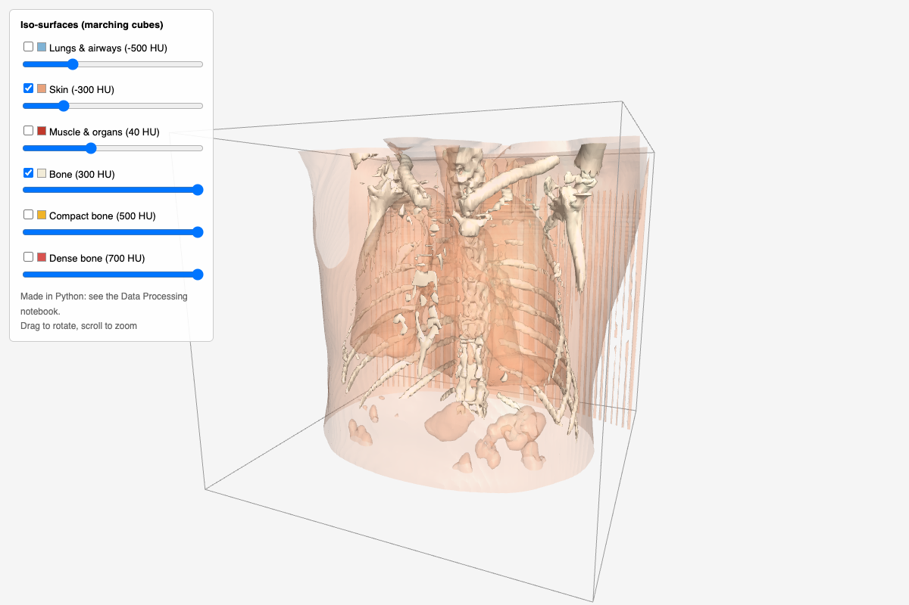
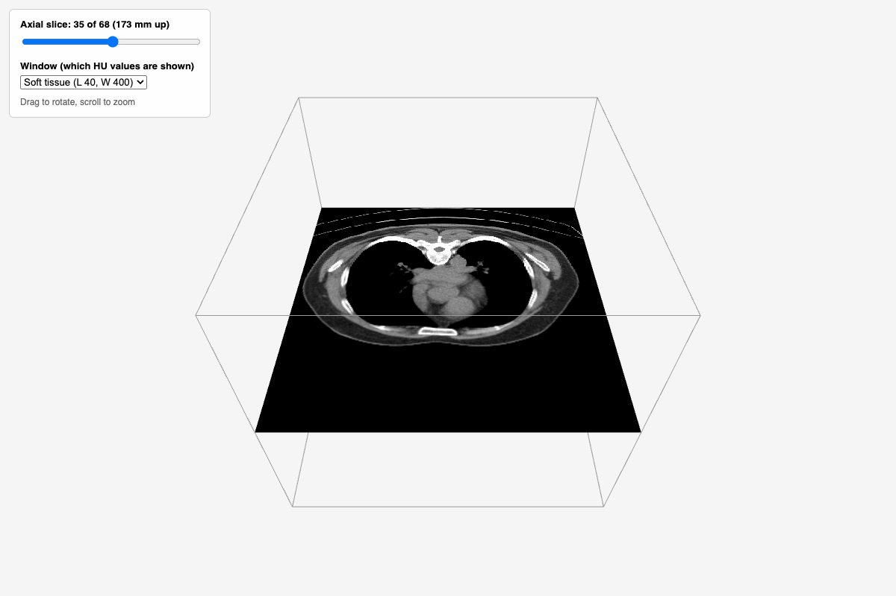
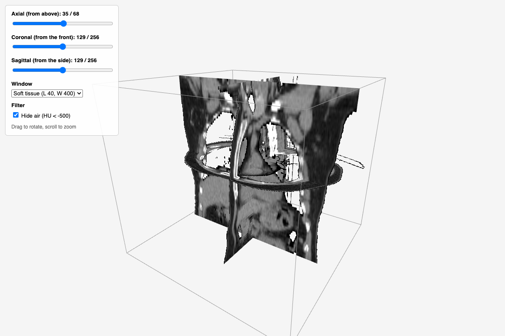
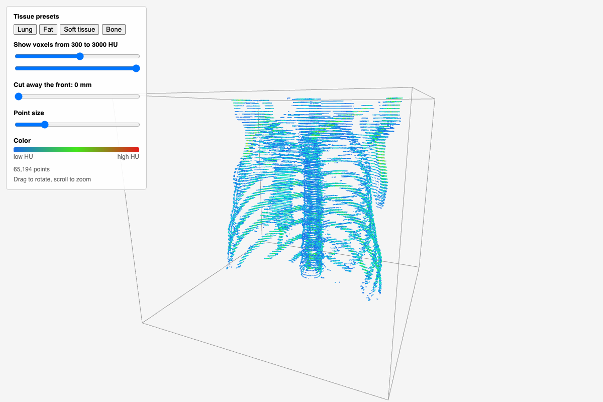

# Example 05 - CT Scan (DICOM) in 3D: Slices, Filters and Iso-Surfaces



This example shows the chest CT scan from **Week 11** (`Week-11/Medical-Data-DICOM`) in three.js.
It builds on Examples 03 and 04: the same `myThreeJS()` set-up function, `OrbitControls`, an HTML panel on top
of the canvas, and (in step 4) the lights and `MeshPhongMaterial` from Example 04.

Run it through a local server (Live Server or `python3 -m http.server`), as described in the
[main README](../README.md#how-to-run-the-examples). The pages load their data with `fetch`, which does not work when
a file is opened directly from disk.

| Page | What it shows | New three.js idea |
|---|---|---|
| `index_01_axial_slice.html` | One CT slice on a plane, with a slider to move up and down the body | `DataTexture`: an image made from our own numbers |
| `index_02_three_views.html` | Axial, coronal and sagittal cuts crossing each other | Turning planes; transparent pixels with `alphaTest` |
| `index_03_hu_filter_points.html` | Only the voxels inside a HU range, as a point cloud | `Points` and `BufferGeometry` with one color per point |
| `index_04_iso_surfaces.html` | Six iso-surfaces (lungs, skin, muscle, bone, …) made with marching cubes | A mesh from vertices + faces, shaded with lights |

## The data

The browser cannot read `.dcm` files, so the notebook in `Data Processing/` converts them once, in Python:

```
Week-11 DICOM_data/*.dcm ──► Data Processing/dicom_to_threejs.ipynb ──┬──► data/ct_volume.bin + ct_volume.json   (pages 01-03)
                                                                      └──► data/surfaces/*.json                  (page 04)
```

- **`data/ct_volume.bin`**: the whole scan as one block of numbers in **Hounsfield Units (HU)**:
  68 slices × 256 rows × 256 columns, 2 bytes (`int16`) per voxel. The page reads it with
  `new Int16Array(buffer)`. Voxel `(z, y, x)` is at index `z * rows * columns + y * columns + x`.
- **`data/ct_volume.json`**: the size of the volume and the size of one voxel in mm
  (1.47 × 1.47 × 5 mm: a voxel is **not a cube**).
- **`data/surfaces/`**: one JSON file per iso-surface (`vertices` and `faces` lists) and `surfaces.json`, the list
  of surfaces with their name, iso-value, color and opacity.

You only need to run the notebook again if you change it (for example, to add a fat surface at −100 HU).
It needs `pip install pydicom numpy scipy scikit-image matplotlib`.

### Axes

All four pages place the volume the same way, scaled so its longest side is 10 units:

| Volume axis | Meaning | three.js axis |
|---|---|---|
| x (column) | across the body | x |
| z (slice) | from the bottom of the scan (upper abdomen) to the top (shoulders) | y (up) |
| y (row) | from the front of the body to the back | z, with the front facing the camera |

## Step 1: one slice (`index_01_axial_slice.html`)



- A **`DataTexture`** is an image whose pixels we fill ourselves: 4 bytes (red, green, blue, alpha) per pixel.
- **Windowing** turns HU into gray. A screen has only 256 grays, but CT goes from −1024 to over +1000 HU, so we choose a
  window: `level` is the HU value shown as middle gray and `width` is the range from black to white.
  The *Lung* window shows the lungs in detail, the *Bone* window shows the bones.
- After changing the pixels we set `texture.needsUpdate = true` so three.js sends them to the GPU again.

## Step 2: three views (`index_02_three_views.html`)



The same 3D array cut in three directions, the standard views in medical imaging:

| View | Cut | Pixel (i, j) of the texture |
|---|---|---|
| Axial | horizontal, as seen from above | column, row |
| Coronal | vertical, as seen from the front | column, slice |
| Sagittal | vertical, as seen from the side | row, slice |

**Filter:** with *Hide air* checked, pixels below −500 HU get alpha 0. `alphaTest: 0.5` tells three.js not to draw
those pixels at all, so you can see the other planes through the holes.

## Step 3: filter voxels by value (`index_03_hu_filter_points.html`)



Every voxel whose HU value is inside `[min, max]` becomes one point; all other voxels are filtered out.
The presets use the HU ranges from Week 11: lung (−900 to −500), fat (−150 to −50), soft tissue (20 to 80) and bone (300 and more).

- **Cut away the front** is a second filter, by position: voxels in the first rows (the front of the body) are skipped,
  so you can look inside.
- All points are stored in one `BufferGeometry` (`position` and `color` attributes) and drawn by one `THREE.Points` object.
  Drawing 600,000 points this way is fast; 600,000 separate sphere meshes (as in Example 03) would not be.
- When the filter changes, the old geometry is removed and `dispose()`d to free its GPU memory.

## Step 4: iso-surfaces (`index_04_iso_surfaces.html`)

The screenshot at the top of this page shows this step: the see-through skin around the bone surface.

An **iso-surface** is the 3D version of a contour line. The notebook runs **marching cubes**
(`skimage.measure.marching_cubes`) at six iso-values, and the page lets you switch each one on or off:

| Surface | Iso-value | Shows | File |
|---|---|---|---|
| Lungs & airways | −500 HU | the walls of the lungs and windpipe (and the outside of the body) | 5.5 MB |
| Skin | −300 HU | the boundary between air and the body, also around gas pockets in the bowel and the scanner table behind the body | 4.3 MB |
| Muscle & organs | 40 HU | soft tissue: the muscles around the ribs and the organs | 6.5 MB |
| Bone | 300 HU | the spine, ribs, collarbones and shoulder blades | 1.3 MB |
| Compact bone | 500 HU | the harder outer layer of the bones | 0.2 MB |
| Dense bone | 700 HU | only the densest bone | 0.1 MB |

The page first reads `surfaces.json` (the list) and builds a checkbox and an opacity slider for every surface.
Only the surfaces marked `"visible": true` (skin and bone) are downloaded when the page opens; any other surface is
downloaded the first time you tick its checkbox. This keeps the first load small (5.6 MB instead of 18 MB).

Before marching cubes the notebook shrinks each slice to 128 × 128 and applies a light **Gaussian filter** to remove noise.
Without these steps the skin surface alone has hundreds of thousands of triangles.

The page turns each file into a mesh:

```js
const geometry = new THREE.BufferGeometry();
geometry.setAttribute("position", new THREE.BufferAttribute(positions, 3));   // the vertices
geometry.setIndex(data.faces);                                                // 3 vertex indices per triangle
geometry.computeVertexNormals();                                              // needed for shading
```

- `MeshPhongMaterial` with an ambient light and a directional light attached to the camera, so the side you look at is always lit.
- The outer surfaces start see-through (skin `opacity: 0.25`), with `depthWrite: false` so they do not hide the surfaces inside them.

**Why Python and not d3?** `d3.contours()` runs marching *squares*: it finds iso-lines on one 2D grid.
Marching *cubes* is the 3D version and is not part of d3 or of the three.js version used here, so we compute the surfaces in Python.
