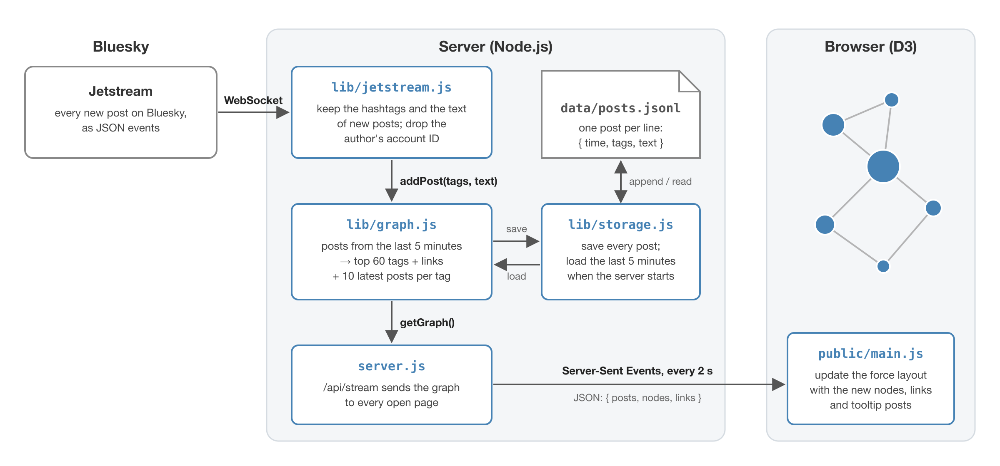

# Example 06: A Live Network of Bluesky Hashtags

This example draws data that
arrives **while you watch**: posts published on Bluesky right now.

Each circle is a hashtag. Two hashtags are linked when they appear in the same post. The graph keeps only the last
5 minutes, so new topics appear, grow and fade away while the page is open.

- **Node size:** how many posts used the tag in the last 5 minutes.
- **Link width:** how many posts used both tags together.

The graph shows **topics, not people**. The server keeps the hashtags and the text of each post, but never the user
name or the account ID. Hover over a tag to read its latest posts.

> **Note:** post text is written by the public and is not filtered. A post can be offensive, and it can mention
> other people by name.

---

## How to run it

This example has a small server, so a static server like Live Server is not enough. You need
[Node.js](https://nodejs.org/) 22 or newer, which has `WebSocket` built in.

```sh
cd "Week-13/Example 06"
npm install      # installs Express, the only package
npm start        # runs server.js
```

Then open <http://localhost:3000>. The first tags appear after a few seconds, and the graph fills up over the next
minutes. Stop the server with **Ctrl + C**. When you start it again, it reads the last 5 minutes back from
`data/posts.jsonl`, so the graph doesn't start empty.

---

## The big picture



There are two connections, and they work differently:

| Connection | Technology | Why |
| --- | --- | --- |
| Bluesky → server | **WebSocket** | Jetstream sends many events per second. The server needs every one of them. |
| Server → browser | **Server-Sent Events (SSE)** | The browser only needs a summary every 2 seconds, and only in one direction. |

Only the server talks to Bluesky. However many browsers open the page, there is one connection to Bluesky, and
every browser gets the same summary.

---

## The files

```text
Example 06/
├── package.json        the project and its one dependency (Express)
├── server.js           starts the web server and the Jetstream connection
├── lib/
│   ├── jetstream.js    reads posts from Bluesky and pulls out the hashtags
│   ├── graph.js        keeps the last 5 minutes and builds the nodes and links
│   └── storage.js      saves the hashtags of every post to a file
├── public/
│   ├── index.html      the page
│   └── main.js         the D3 force layout
└── data/
    └── posts.jsonl     created when the server runs (not in the repository)
```

---

## Step 1: Reading the stream (`lib/jetstream.js`)

[Jetstream](https://docs.bsky.app/blog/jetstream) is a public service that sends every event on Bluesky as
JSON over a WebSocket. Adding `?wantedCollections=app.bsky.feed.post` to the address keeps only posts. Each event
looks like this (shortened):

```json
{
  "did": "did:plc:…",
  "kind": "commit",
  "commit": {
    "operation": "create",
    "collection": "app.bsky.feed.post",
    "record": {
      "text": "Great game tonight #nba #basketball",
      "langs": ["en"],
      "facets": [
        { "features": [{ "$type": "app.bsky.richtext.facet#tag", "tag": "nba" }] },
        { "features": [{ "$type": "app.bsky.richtext.facet#tag", "tag": "basketball" }] }
      ]
    }
  }
}
```

The hashtags are already marked in `facets`, so we don't have to search the text for `#`. The code:

1. keeps only events where a post was **created** (not deleted or edited),
2. collects the `tag` of every facet feature of type `…#tag`, in lowercase and without duplicates,
3. passes that list of tags and the post's `text` to the rest of the program. Everything else in the event, including
   the author's account ID (`did`), is dropped here.

If the connection closes, it waits 3 seconds and connects again.

## Step 2: A sliding time window (`lib/graph.js`)

`addPost(tags, text)` stores each post as `{ time, tags, text }`, after removing tags on the **blocklist**. Hashtags
are written by the public and can be offensive; the blocklist keeps some of them out of the network.
The blocklist removes tags only; it does not hide a post whose *text* is offensive.

`getGraph()` runs every 2 seconds and builds the graph from scratch:

1. **Drop old posts.** Anything older than 5 minutes is removed. This is a *sliding window*: the data always
   describes the last 5 minutes, not everything since the server started.
2. **Count the tags.** Each tag's count becomes its node size.
3. **Keep the top 60.** A network with thousands of tiny nodes is unreadable, so only the 60 most used tags are sent.
4. **Count the pairs.** For each post, every pair of its tags that are in the top 60 adds 1 to that link. A post
   with tags A, B and C adds the links A–B, A–C and B–C. This is called a **co-occurrence network**.
5. **Pick a few posts.** Each tag gets the text of its 10 latest posts (`POSTS_PER_TAG`), for the tooltip. Sending
   only 10 keeps each update small, even when a tag was used hundreds of times.

The result is the same `{ nodes, links }` shape you used for the force layouts in Week 8:

```json
{
  "posts": 111,
  "nodes": [{ "id": "jersey", "count": 10, "posts": ["…", "…", "…"] }, { "id": "hoodie", "count": 4, "posts": ["…"] }],
  "links": [{ "source": "jersey", "target": "hoodie", "count": 2 }]
}
```

## Step 2b: Saving the posts to a file (`lib/storage.js`)

The `posts` list lives in memory, so it disappears when the server stops. To keep the data, `addPost()` also saves
each post to `data/posts.jsonl`. The file uses the **JSON Lines** format: one JSON object per line.

```text
{"time":1764012345678,"tags":["nba","basketball"],"text":"Great game tonight #nba #basketball"}
{"time":1764012345912,"tags":["photography"],"text":"Morning light #photography"}
```

JSON Lines suits a stream better than one big JSON array, for two reasons:

- **Adding a post is cheap.** The file is opened once in *append* mode (`fs.createWriteStream(FILE, { flags: "a" })`),
  and each new post is one more line at the end. A JSON array would have to be rewritten as a whole to add an item.
- **Reading it is simple.** Split the file on `"\n"` and `JSON.parse` each line. When the server starts,
  `loadPostsSince()` does this and keeps only the posts from the last 5 minutes.

The file holds the time, the hashtags and the text of each post: no user names, no account IDs. It grows by about
5 MB per hour while the server runs. Delete the `data/` folder to start over.

Because the file has no account IDs, it can't follow deletions: if someone deletes a post on Bluesky, its text stays
in your file. Delete the file when you are done instead of keeping it.

## Step 3: Sending updates (`server.js`)

The server has two routes:

- **`/api/graph`** returns one snapshot. Open it in the browser to see the JSON.
- **`/api/stream`** keeps the request open and sends a new graph every 2 seconds, using Server-Sent Events.

An SSE response is plain text. Each message is a line that starts with `data:` and ends with an empty line:

```text
data: {"posts":111,"nodes":[…],"links":[…]}

data: {"posts":114,"nodes":[…],"links":[…]}
```

In the browser, `new EventSource("/api/stream")` reads these messages and calls `onmessage` for each one. If the
connection drops, `EventSource` reconnects by itself.

## Step 4: A force layout that keeps moving (`public/main.js`)

The network code is taken from **Week 8, Example 8.7**
([`Week-8-ForceSimulator/Example 8.7/network.js`](../../Week-8-ForceSimulator/Example%208.7/network.js)): the same
`main_group`, the link and node groups moved to the center of the SVG, the same forces (`forceX`, `forceY`,
`forceManyBody`, `forceCollide`, `forceLink`), nodes drawn as a `<g>` with a circle and a label, and the same zoom
code. If that example is clear, most of this file will look familiar.

In Example 8.7 the data was loaded once, and the simulation ran until it settled. Here new data arrives every 2
seconds, so a few things change:

- **One simulation for the whole page.** It is created once, outside `update()`. Each update gives it the new nodes
  and links and *reheats* it a little (`alpha(0.3).restart()`) instead of starting over.
- **Keep the old positions.** A tag that was already on screen keeps its `x`, `y`, `vx` and `vy`:

  ```js
  const old = new Map(nodes.map(d => [d.id, d]));
  nodes = graph.nodes.map(d => Object.assign(old.get(d.id) ?? {}, d));
  ```

  Without this, every node would jump back to the center every 2 seconds.
- **`join` instead of `enter`.** Example 8.7 uses `.enter().append(...)`, which is enough when the data never
  changes. Here `.data(nodes, d => d.id).join(...)` matches each tag to the same `<g>` element as last time. New tags
  are added, tags that dropped out of the top 60 are removed, and the rest stay where they are.
- **Stay on screen.** `forceX` and `forceY` pull every node toward the middle, so loose clusters don't drift away.
  On every tick, each node's `x` and `y` are also clamped to the size of the SVG, so no node can leave it.
- **Copy the links.** `forceLink` replaces `source` and `target` with the node objects. Copying each link
  (`{ ...d }`) keeps the data from the server unchanged.

### Zoom and drag

- **Zoom and pan** use the same code as Example 8.7: `d3.zoom()` on the SVG moves and scales `main_group`. Scroll to
  zoom in, and drag the background to move around.
- **Drag** a circle to move it. While you hold it, its `fx` and `fy` (fixed x and y) follow the mouse, so the
  simulation can't move it. When you let go, `fx` and `fy` are set back to `null` and the node joins the layout
  again.

### Tooltip

Hover over a circle to see the tag, its count and its 10 latest posts. The tooltip is a `<div>` that is shown on
`mouseover`, follows the mouse on `mousemove` and is hidden on `mouseout`.

Why not the SVG `<title>` element, the browser's built-in tooltip? It appears only after the mouse rests on an element
for a moment. Here the nodes keep moving and the data is replaced every 2 seconds, so the built-in tooltip closes
before it opens.

The post text goes into the tooltip with `.text()`, not `.html()`. A post could contain HTML, and `.text()` shows it
as plain characters instead of running it as part of the page.
