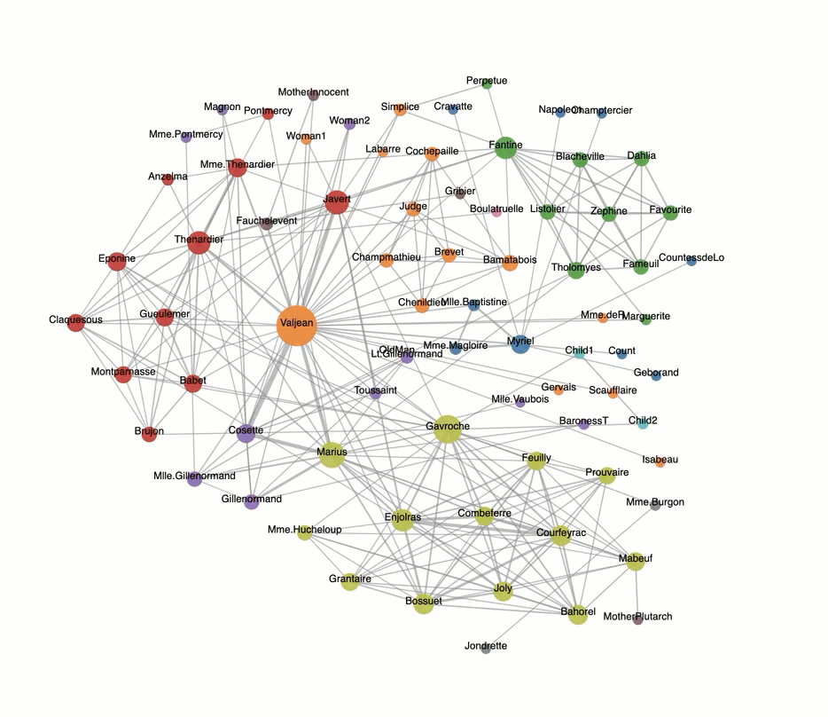

# Week 8: Network Visualization and Force Layout

## Running the examples

From this folder, start a local server:

```sh
python3 -m http.server 8000
```

Open <http://localhost:8000> and choose an example folder. Use HTTP rather
than opening the HTML files directly: several examples fetch JSON or load
JavaScript modules. Examples 8.1 and 8.3–8.7 also require internet access to
load D3 from the CDN.

## How force simulations work

D3's `forceSimulation` updates node positions and velocities in discrete ticks.
Registered forces influence the layout, and a velocity decay damps movement.

The parameter **alpha** acts like a temperature. By default, it starts at 1 and
approaches 0. The automatic timer stops when alpha falls below `alphaMin`.
Link, many-body, and positioning forces scale their effects with alpha;
collision and centering forces do not. Cooling reduces the influence of forces
that use alpha, but does not guarantee a stable or overlap-free layout.

Use `.on("tick", render)` to render automatic updates. To advance manually,
stop the timer and call `.tick(iterations)`. Manual ticks update the data without
dispatching tick events, so call your render function explicitly afterward.

## Examples

1. [Example 8.1](<Example 8.1/index.html>): Generate nodes with `d3.range()`
   and position them using `forceX`, `forceY`, and `forceCollide`.
2. [Example 8.2](<Example 8.2/index.html>): Generate a random network with
   link, many-body, collision, and positioning forces. Connectivity is not guaranteed.
   [Interactive controls](<Example 8.2/indexControlled.html>) adjust collision
   radius, charge, and link strength.
3. [Example 8.3](<Example 8.3/index.html>): Load the Les Misérables character
   network and render it with a reusable `simulate` function.
4. [Example 8.4](<Example 8.4/index.html>): Set link strength and distance,
   and size nodes by degree (the number of incident link endpoints).
5. [Example 8.5](<Example 8.5/index.html>): Add pan and zoom interaction.
6. [Example 8.6](<Example 8.6/index.html>): Add node labels to the zoomable network.
7. [Example 8.7](<Example 8.7/index.html>): Hover over a node to highlight its
   group and dim other groups.



See the [step-by-step guide](Step_by_Step/readme.md) for individual forces and controls.

## References

- [D3 force documentation](https://d3js.org/d3-force)
- [D3 force source](https://github.com/d3/d3-force)
- [Observable force-directed graph](https://observablehq.com/@d3/force-directed-graph)
- [D3 in Depth: Force layout](https://www.d3indepth.com/force-layout/)
