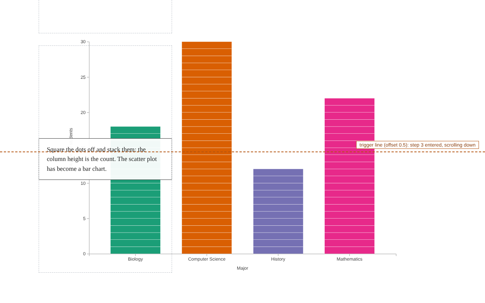
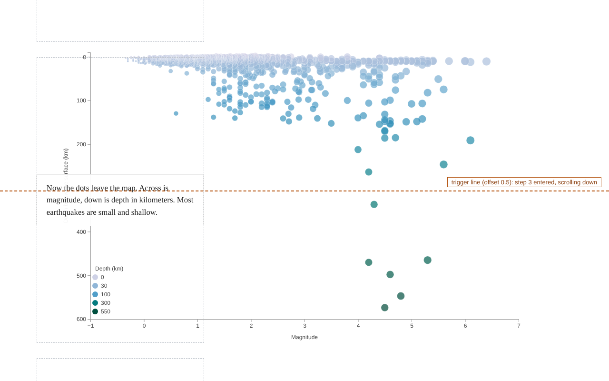
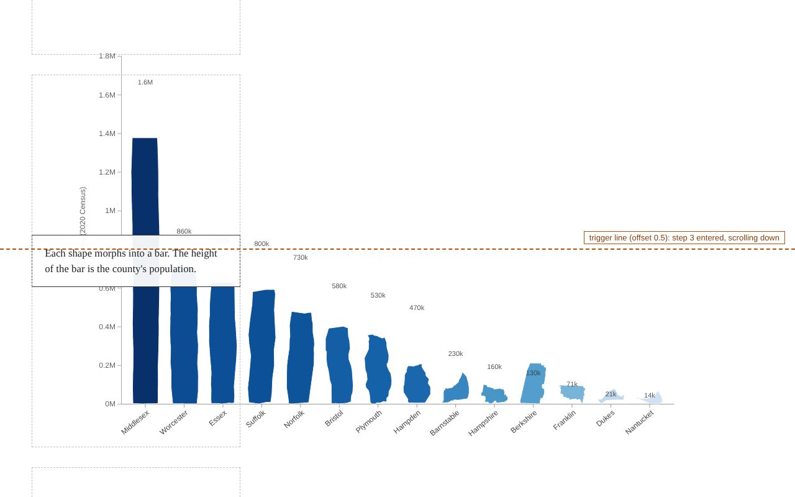

# Week-9 D3 js and Scrollama

Scrollytelling is a way of telling a story with data where the chart changes as the reader scrolls. This week combines two libraries:

- **[Scrollama](https://github.com/russellsamora/scrollama)** watches the page and tells you which paragraph (step) the reader has reached.
- **[D3](https://d3js.org/)** draws the chart and animates it into a new form for each step.

All three examples use Scrollama's [sticky-overlay pattern](https://russellsamora.github.io/scrollama/sticky-overlay): the chart stays pinned in the middle of the screen while text cards scroll over it.

## How to run the examples

Open any of the HTML files in a browser (double-click it, or drag it onto a browser window). No build step or local server is needed.

You do need an internet connection: the libraries are loaded from public CDNs, and Examples 2 and 3 also download their map or data files.

## Example-1: from scatter plot to bar chart

Each dot is one student (fictional data generated with a fixed random seed). The story has four steps:

1. A gray scatter plot of hours studied per week against exam score.
2. The same dots, colored by major.
3. The dots move into one column per major.
4. The dots square off and stack into bars, so each bar's height is the number of students.



The trick is that every dot is an SVG `<rect>` with rounded corners. A rect can look like a circle or like a slice of a bar, so the same 82 elements animate from one chart to the other. The full walkthrough is in [tutorial.md](tutorial.md).

## Example-2: earthquakes, from map to scatterplot

Real data: every earthquake the U.S. Geological Survey recorded in one week of February 2018. The story has six steps:

1. A world map.
2. Each earthquake appears at its epicenter, sized by magnitude.
3. Color shows depth below the surface.
4. The dots leave the map and form a scatterplot of magnitude (across) against depth (down).
5. The earthquakes of magnitude 4.5 or more are highlighted.
6. Back on the map, the strong earthquakes are spread around the world, while most of the small ones were recorded in North America, where sensor networks are dense enough to detect them.



Example-2 follows the same structure as Example-1 (a `layouts` array and one `render(step)` function), with three additions:

- It loads data with `d3.json` and starts Scrollama only after the data arrives.
- Positions come from a map projection (`d3.geoNaturalEarth1`) in the map steps and from linear scales in the scatterplot steps.
- Numbers in the card text, such as how many earthquakes reached magnitude 4.5, are computed from the data when the page loads instead of being typed in.

## Example-3: Massachusetts counties, from map to bar chart

Where Example-2 moves dots across a map, Example-3 transforms the map itself: each county's boundary shape turns into a bar whose height is the county's population in the 2020 Census. The story has six steps:

1. The 14 counties of Massachusetts, all in gray.
2. A choropleth: each county colored by population (log scale, darker means more people).
3. The counties lift off the map and line up from most to least populous, each shape resized to fit the same slot.
4. Each shape morphs into a bar of the bar chart.
5. The four most populous counties are highlighted; the card states their share of the state total, computed from the data.
6. Back on the map with the same four counties highlighted.



### How a county becomes a bar

D3 transitions can interpolate numbers, colors and transforms, but not one *shape* into a different shape: two path strings with different numbers of points do not line up. Example-3 adds the small [flubber](https://github.com/veltman/flubber) library, which can morph any polygon into any other. Each county is one `<path>`, and every layout only writes a target path string:

- **Map steps:** the county as drawn by `d3.geoPath(projection)`.
- **Row step:** the same county run through a `d3.geoTransform` that projects each point, then scales and moves it into its slot.
- **Bar steps:** a rectangle written as a closed path, `M x0,bottom L x0,top L x1,top L x1,bottom Z`.

`render(step)` then morphs each path from whatever is on screen to its target:

```js
shapes.transition(t)
  .attrTween("d", function (c) {
    // from the current shape (even halfway through a morph) to this step's target
    return flubber.interpolate(this.getAttribute("d"), c.target, { maxSegmentLength: 4 });
  });
```

Because it always starts from the shape currently on screen, scrolling up turns the bars back into counties with no extra code.

One detail: flubber morphs a single outline into a single outline. Counties with islands (Dukes, Nantucket, parts of Bristol and Norfolk) keep their largest polygon as the shape that morphs; the smaller islands are drawn in a separate layer that fades out when the shapes leave the map.

## The trigger line

All three examples draw a dashed orange **trigger line** across the screen and outline each step with a gray dashed box. A step fires when the top or bottom edge of its box crosses the line. The label on the line shows each event as it happens, for example "step 2 entered, scrolling down".

The line is placed by the same `OFFSET` value that is passed to Scrollama, so changing that one number moves both the visible line and the real trigger. These are teaching aids; delete the `#trigger-line` element and the `.step` outline rule before publishing a real story.


## Libraries and versions

| Library | Version | Used in |
| --- | --- | --- |
| D3 | 7.9.0 | all |
| Scrollama | 3.2.0 | all |
| topojson-client | 3.1.0 | Examples 2 and 3 |
| flubber | 0.4.2 | Example-3 |

## Data sources

- Example-1: fictional data generated in the page.
- Example-2: the USGS "All Earthquakes, Past Week" feed from February 2018, as packaged in [vega-datasets](https://github.com/vega/vega-datasets) 2.8.0. Explosions and quarry blasts in the feed are filtered out.
- Example-3: U.S. Census Bureau, 2020 Census population counts for the 14 Massachusetts counties (they sum to the state total of 7,029,917), typed into the page.
- Example-3 county shapes: U.S. Census Bureau cartographic boundary files, as packaged in [us-atlas](https://github.com/topojson/us-atlas) 3.0.1.
- Example-2 country shapes: [Natural Earth](https://www.naturalearthdata.com/) 1:110m, as packaged in [world-atlas](https://github.com/topojson/world-atlas) 2.0.2.

## Exercises

1. In Example-1, add a fifth step that turns the count bars into bars of average exam score. The tutorial walks through the three edits this needs.
2. In Example-1, add a step that sorts the bars from tallest to shortest.
3. In Example-2, change `OFFSET` to 0.2 and watch where the steps now fire.
4. In Example-2, add a step that shows only the earthquakes deeper than 300 km.
5. In Example-3, add a step that sorts the bars alphabetically instead of by population. Only the order of the band scale's domain changes.
6. In Example-3, replace the population numbers with another county statistic of your choice and rewrite the card text to match.

## Further reading

- [Scrollama repository and API reference](https://github.com/russellsamora/scrollama)
- [Scrollama sticky-overlay example](https://russellsamora.github.io/scrollama/sticky-overlay)
- [The Pudding: how to use position sticky for scrollytelling](https://pudding.cool/process/scrollytelling-sticky/)
- [D3 transitions](https://d3js.org/d3-transition)
- [D3 geographic projections](https://d3js.org/d3-geo)
- [flubber: smooth shape interpolation](https://github.com/veltman/flubber)
