# Tutorial: Scrollytelling with D3 and Scrollama

This tutorial explains how `Example-1.html` works, from an empty page to a scatter plot that turns into a bar chart as the reader scrolls. Every code block below is taken from `Example-1.html`, so you can keep the file open and follow along.

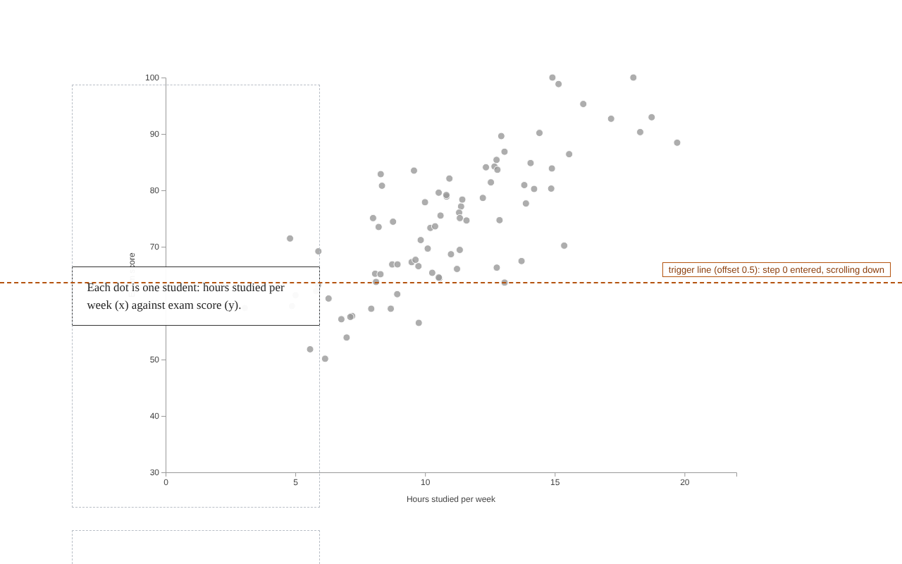

## Contents

1. [What Scrollama does](#1-what-scrollama-does)
2. [The sticky-overlay pattern](#2-the-sticky-overlay-pattern)
3. [Load the libraries](#3-load-the-libraries)
4. [The HTML structure](#4-the-html-structure)
5. [Each name appears in three places](#5-each-name-appears-in-three-places)
6. [The CSS that makes the figure stick](#6-the-css-that-makes-the-figure-stick)
7. [Grab the elements in JavaScript](#7-grab-the-elements-in-javascript)
8. [Size the figure and the steps](#8-size-the-figure-and-the-steps)
9. [Make the trigger line visible](#9-make-the-trigger-line-visible)
10. [Create the scroller and listen for steps](#10-create-the-scroller-and-listen-for-steps)
11. [How a card gets the is-active class](#11-how-a-card-gets-the-is-active-class)
12. [The chart is not inside the steps](#12-the-chart-is-not-inside-the-steps)
13. [One rect per data point](#13-one-rect-per-data-point)
14. [Layout functions](#14-layout-functions)
15. [render(step): one function draws every state](#15-renderstep-one-function-draws-every-state)
16. [One scroll, traced through the code](#16-one-scroll-traced-through-the-code)
17. [Exercise: add a step of your own](#17-exercise-add-a-step-of-your-own)
18. [Common problems](#18-common-problems)
19. [Reference: options and callbacks](#19-reference-options-and-callbacks)

---

## 1. What Scrollama does

Scrollama does one job: it watches a list of **step** elements while the reader scrolls, and when the edge of a step crosses an invisible **trigger line**, it calls a function you wrote and tells you which step it was.

It does not draw or animate anything. What each step changes is entirely up to you. In this example D3 redraws a chart, but a step could just as well change a CSS class, move a map, or play a video.

Scrollama uses the browser's IntersectionObserver instead of listening to every scroll event, so it stays fast on long pages.

The whole chain, from the reader's scroll to the redrawn chart:

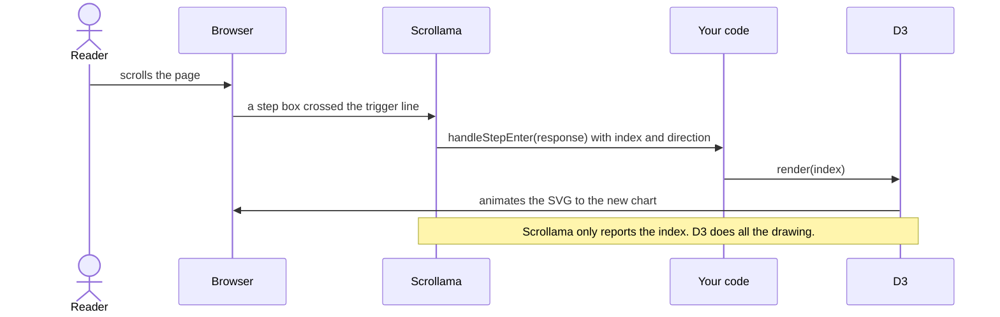

> Scrollama tells you **where the reader is**. D3 decides **what the chart looks like** at that point.

## 2. The sticky-overlay pattern

The page has three parts:

- **`#scrolly`** is the section that holds the whole story.
- **`figure`** holds the chart. It uses `position: sticky`, so it stays pinned in the middle of the screen while the reader scrolls through the section.
- **`article .step`** are the text cards. They come after the figure in the page, so they scroll *over* it. That is the "overlay".

A fourth thing is invisible by default: the **trigger line**, a horizontal line across the screen (halfway down, unless you change it). When the edge of a step crosses that line, Scrollama fires.

Text before and after `#scrolly` (the intro and outro sections) scrolls normally.

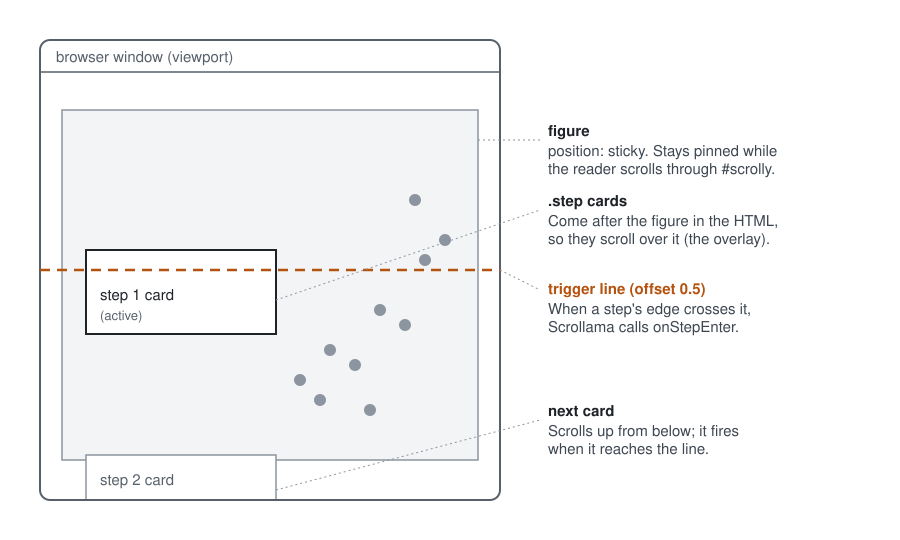

The same page as an element tree. Only the parts inside `#scrolly` take part in the scrollytelling:

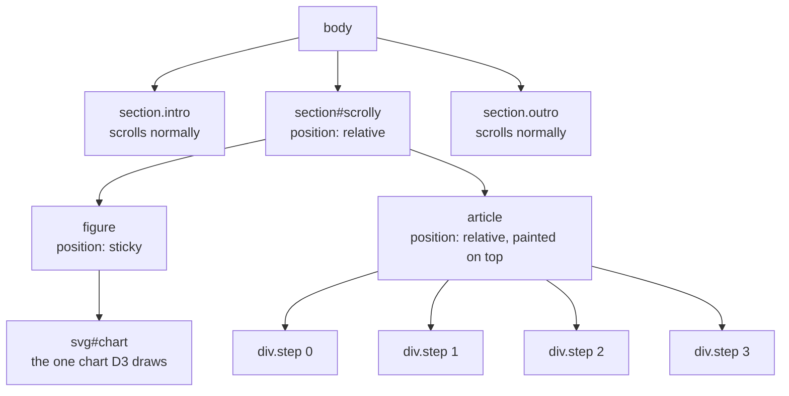

## 3. Load the libraries

Add the two libraries at the end of the `<body>`, before your own script. Pin the version in each URL: a bare `unpkg.com/scrollama` always serves the newest release, which could change under you.

```html
<script src="https://cdn.jsdelivr.net/npm/d3@7.9.0"></script>
<script src="https://unpkg.com/scrollama@3.2.0"></script>
<script>
  // your code goes here
</script>
```

The script-tag version of Scrollama defines a global function called `scrollama`.

If you use a bundler such as Vite instead, install the packages and import them:

```bash
npm install scrollama d3
```

```js
import scrollama from "scrollama";
import * as d3 from "d3";
```

## 4. The HTML structure

```html
<section id="scrolly">
  <figure>
    <svg id="chart"></svg>
  </figure>

  <article>
    <div class="step" data-step="0">
      <p>Each dot is one student: hours studied per week (x) against exam score (y).</p>
    </div>
    <div class="step" data-step="1">
      <p>Color the dots by major. The groups overlap a lot in this view.</p>
    </div>
    <div class="step" data-step="2">
      <p>Now move every dot into a column for its major. Same marks, new positions.</p>
    </div>
    <div class="step" data-step="3">
      <p>Square the dots off and stack them: the column height is the count. The scatter plot has become a bar chart.</p>
    </div>
  </article>
</section>
```

Three things to notice:

- The `figure` comes first and the `article` second. Elements later in the page are painted on top, which is what puts the cards over the chart.
- There is one `.step` per stage of the story. Scrollama only needs the class; `data-step` is just a label for you.
- The `svg` starts empty. D3 fills it later.

## 5. Each name appears in three places

The ids and classes are the glue between HTML, CSS and JavaScript. This table shows where each one is written, styled and used:

| Name | Written in the HTML | Styled in the CSS | Used in the JavaScript |
| --- | --- | --- | --- |
| `#scrolly` | id of the `<section>` | `position: relative` | `d3.select("#scrolly")` |
| `figure` | the `<figure>` tag | `position: sticky` | sized in `handleResize()` |
| `#chart` | id of the `<svg>` | not styled | `d3.select("#chart")`: D3 draws here |
| `.step` | class of each card | height, spacing | given to Scrollama in `setup({ step })` |
| `data-step` | attribute of each card | not styled | optional label, `element.dataset.step` |
| `.is-active` | **not in the HTML** | `.step.is-active p` | **added and removed by our own code** |

You choose all of these names; they only have to match across the three places. Scrollama does not require a class called `step` (it uses whatever selector you pass to `setup`), and it does not add `is-active` itself (our callback does, see section 11).

The selector syntax is the same in CSS and in D3: `#` means id, `.` means class, and a bare word means a tag.

The same connections, one row per name. Each row reads left to right in the order the name is used. The last row is different: `is-active` starts in the JavaScript, which writes it onto a card, and only then does the CSS rule apply:

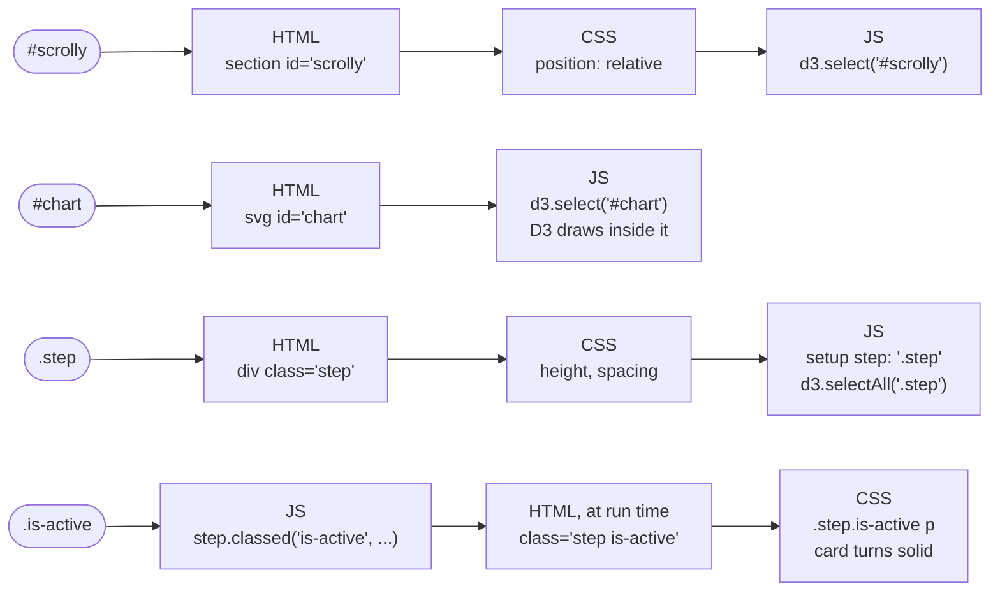

## 6. The CSS that makes the figure stick

```css
#scrolly {
  position: relative;          /* the scroll story container */
}
#scrolly figure {
  position: sticky;            /* the graphic stays in view */
  left: 0;
  width: 100%;
  margin: 0;
  z-index: 0;                  /* sits underneath the text */
  /* top and height are set in JS (handleResize) */
}
#scrolly article {
  position: relative;          /* later in the DOM, so it paints on top */
  max-width: 22rem;
  margin: 0 auto 0 8%;
  padding: 0;
  z-index: 1;
}
.step {
  margin: 0 0 2rem 0;
  display: flex;
  align-items: center;         /* card sits in the middle of the tall step */
}
.step p {
  /* ...card styling... */
  opacity: 0.35;
  transition: opacity 0.3s;
}
.step.is-active p { opacity: 1; border-color: #333; }
```

- `position: sticky` only works together with a `top` value. We set `top` from JavaScript so the figure is centered at any screen height.
- Sticky silently stops working if any ancestor of the figure has `overflow: hidden` or `overflow: auto`.
- Each `.step` is much taller than its text card (75% of the screen, set in JavaScript), and `align-items: center` places the card in the middle of that tall box. Keep this in mind for section 9: the trigger fires on the edge of the **box**, not the card.

## 7. Grab the elements in JavaScript

At the top of the script, look up the elements once, by the names from section 5:

```js
const scrolly = d3.select("#scrolly");
const figure  = scrolly.select("figure");
const step    = scrolly.selectAll(".step");
const svg     = d3.select("#chart");
const scroller = scrollama();
```

- `d3.select` returns the first match; `d3.selectAll` returns every match. So `step` holds all four cards, and one change to `step` reaches all of them.
- These variables are used by everything that follows: `handleResize()` sizes `figure` and `step`, `render()` draws into `svg`, and the callback highlights one card in `step`.
- If a name here does not match the HTML, `d3.select` returns an empty selection and nothing happens, with no error message. Checking these lines is the first debugging step.

## 8. Size the figure and the steps

```js
function handleResize() {
  const stepH = Math.floor(window.innerHeight * 0.75);
  step.style("height", stepH + "px");

  const figureHeight = Math.floor(window.innerHeight * 0.8);
  const figureMarginTop = (window.innerHeight - figureHeight) / 2;
  figure.style("height", figureHeight + "px")
        .style("top", figureMarginTop + "px");

  const fullW = figure.node().getBoundingClientRect().width;
  svg.attr("width", fullW).attr("height", figureHeight);
  width  = Math.min(fullW, 900) - margin.left - margin.right;
  height = figureHeight - margin.top - margin.bottom;
  g.attr("transform", `translate(${(fullW - width) / 2},${margin.top})`);

  drawLegend();
  render(currentStep, false);
}
```

- **Step height sets the pace.** Taller steps mean more scrolling between changes.
- The figure is 80% of the screen tall, and its `top` centers it vertically.
- After resizing, the chart is redrawn in its current state without animation (`false`).
- Scrollama 3 watches for size changes itself, so you no longer need to call `scroller.resize()` (older tutorials do).

## 9. Make the trigger line visible

The trigger line is normally invisible, which makes Scrollama hard to understand. Example-1 draws it, so you can watch steps fire.

**HTML**: one element for the line, with a label inside.

```html
<div id="trigger-line"><span>trigger line (offset 0.5)</span></div>
```

**CSS**: pin it to the screen, and outline the step boxes so you can see their edges.

```css
#trigger-line {
  position: fixed;             /* stays at the same screen height while you scroll */
  left: 0;
  right: 0;
  /* top is set in JS from OFFSET, the same number Scrollama uses */
  border-top: 2px dashed #b4530f;
  z-index: 10;                 /* above the chart and the cards */
  pointer-events: none;        /* clicks pass through it */
}
.step { outline: 1px dashed #b8bec6; outline-offset: -1px; }
```

**JavaScript**: one number places both the visible line and Scrollama's real one.

```js
// Where the trigger line sits: 0 = top of the screen, 0.5 = middle, 1 = bottom.
// The same number is given to Scrollama and used to draw the visible line.
const OFFSET = 0.5;
const triggerLine  = d3.select("#trigger-line").style("top", OFFSET * 100 + "%");
const triggerLabel = triggerLine.select("span");
```

Later, `OFFSET` is passed to `scroller.setup()` (section 10), so the dashed line on screen *is* the trigger, not a picture of it. Try changing `OFFSET` to `0.2`: the line moves near the top of the screen and the steps fire earlier.

The diagram below shows the detail that confuses most people: the trigger watches the edge of the tall step **box**, not the text card.

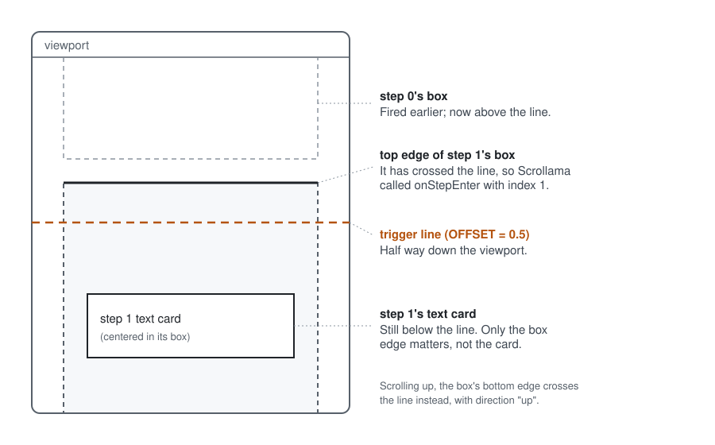

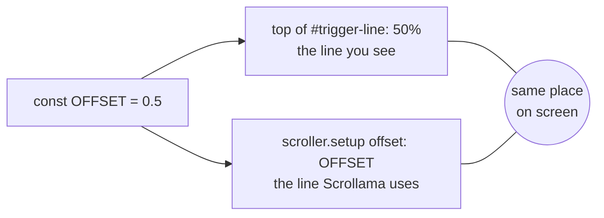

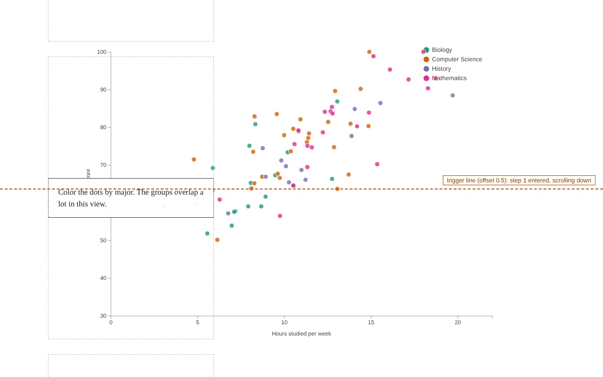

What the screenshot shows:

- The gray dashed boxes are the `.step` elements. The text card is only the visible middle of each box.
- Step 1 fired when the **top edge of its box** crossed the orange line. That is why the card can still be below the line.
- When scrolling up, a box's **bottom edge** crosses the line, and the label reports "scrolling up".

Scrollama has its own `debug: true` option that draws a similar line. The version here is ordinary code you can read and change. Delete the line and the outline rule before publishing a real story.

## 10. Create the scroller and listen for steps

```js
function handleStepEnter(response) {
  // response = { element, index, direction }
  step.classed("is-active", (d, i) => i === response.index);
  currentStep = response.index;
  render(currentStep);

  // show the event on the trigger line's label
  triggerLabel.text(`trigger line (offset ${OFFSET}): step ${response.index} entered, scrolling ${response.direction}`);
}

function init() {
  handleResize();
  scroller
    .setup({
      step: "#scrolly article .step",
      offset: OFFSET,            // the trigger line
      debug: false
    })
    .onStepEnter(handleStepEnter);
  window.addEventListener("resize", handleResize);
}
init();
```

- `scrollama()` creates the scroller (section 7). `setup()` tells it which elements are steps and where the trigger line is.
- `setup()` returns the scroller, so `.onStepEnter(...)` chains onto it.
- `handleResize()` runs **before** `setup()`, so Scrollama measures the final layout.
- Every time a step's edge crosses the line, Scrollama calls `handleStepEnter` with an object. `response.index` is the step's position in the list, counting from 0. That number is all we need.

The order in which things happen, from page load to the first steps:

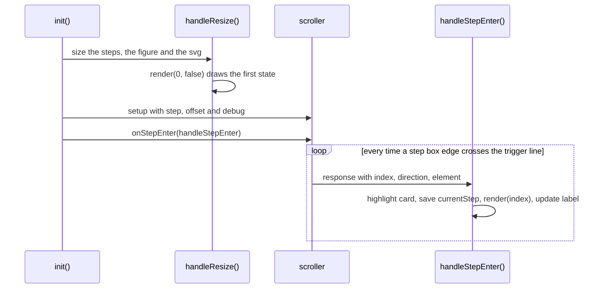

This is the whole Scrollama part of the page. Everything after this section is about what `render()` does with the index.

## 11. How a card gets the is-active class

**1. The CSS describes the class in advance.** At first no card has it, so the rule matches nothing.

```css
.step p { opacity: 0.35; }                              /* every card: faded */
.step.is-active p { opacity: 1; border-color: #333; }   /* active card: solid */
```

**2. The callback adds it to one card and removes it from the rest.**

```js
step.classed("is-active", (d, i) => i === response.index);
```

`classed(name, test)` runs the test once for every card in `step`. `i` is the card's position (0, 1, 2, 3). Where the test returns `true` the class is added; where it returns `false` the class is removed.

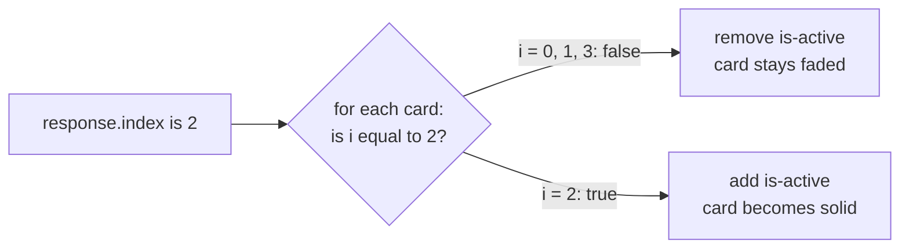

**3. The result after Scrollama reports index 2:**

```html
<div class="step">            <!-- i = 0, false -->
<div class="step">            <!-- i = 1, false -->
<div class="step is-active">  <!-- i = 2, true  -->
<div class="step">            <!-- i = 3, false -->
```

Open your browser's developer tools on Example-1 and watch the Elements panel while scrolling: the `is-active` class jumps from card to card. The highlight is pure CSS, and this one line has nothing to do with the chart.

## 12. The chart is not inside the steps

This is the idea most people miss the first time.

```html
<figure>
  <svg id="chart"></svg>       <!-- the ONLY chart -->
</figure>

<article>
  <div class="step">           <!-- index 0: text only -->
  <div class="step">           <!-- index 1: text only -->
  <div class="step">           <!-- index 2: text only -->
  <div class="step">           <!-- index 3: text only -->
</article>
```

- There is **one** svg, drawn once, in the sticky figure. It is never copied into the cards.
- A step card holds only the sentence the reader sees. It contains no chart code.
- The link between a card and the chart is a single number: the card's position in the list, which Scrollama hands you as `response.index`.

So "adding a visualization to a step" means: **when that step's index arrives, redraw the one chart in the state that step needs.**

Each index selects a chart state:

| Index | Card text | Layout that runs | What the chart shows |
| --- | --- | --- | --- |
| 0 | "Each dot is one student..." | `scatterLayout` | gray scatter plot |
| 1 | "Color the dots by major..." | `scatterLayout` | same dots, colored, legend on |
| 2 | "Now move every dot into a column..." | `columnLayout` | dots grouped by major |
| 3 | "Square the dots off and stack them..." | `barLayout` | bar chart of counts |

The whole table lives in one array, written in the same order as the cards:

```js
// one layout per step card, in the same order as the cards in the HTML
const layouts = [scatterLayout, scatterLayout, columnLayout, barLayout];
```

When index 2 arrives, `layouts[2]` is `columnLayout`. Steps 0 and 1 share a layout because only the color differs, and `render()` handles color itself.

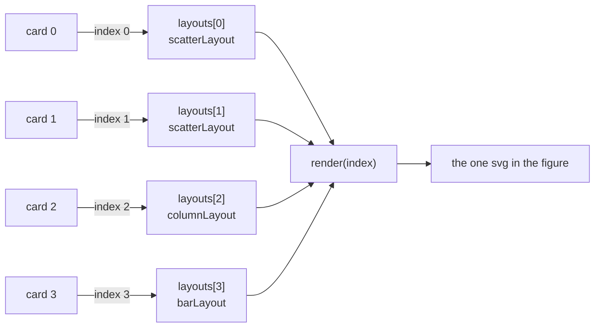

Because each index always produces the same chart, the story can move in either direction. Scrolling down moves forward through these states, and scrolling up moves back:

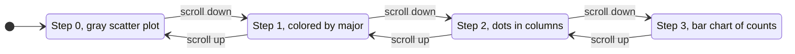

## 13. One rect per data point

The data is an array of 82 fictional students, each with an `id`, a `major`, `hours`, a `score`, and a `rank` (the student's position within their major: 0, 1, 2, ...).

D3 creates one SVG element per student:

```js
// One <rect> per student. A rect with rx = half its width draws a circle,
// so the same element can morph from dot to bar slice.
let marks = g.append("g").selectAll("rect")
  .data(data, d => d.id)
  .join("rect");
```

Why a `<rect>` and not a `<circle>`? A circle cannot become a bar, but a rect can become either:

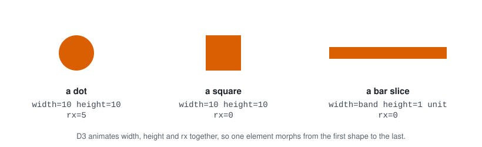


- `rx` = half the width: a dot
- `rx` = 0: a square
- wide and short: one slice of a bar

We never add or remove elements during the story; we only change their attributes. The key function `d => d.id` makes D3 match each rect to the same student every time, so each dot visibly travels to its new place.

## 14. Layout functions

A layout function computes where every rect should be for one state of the chart. It writes the targets onto each data object (`d.x`, `d.y`, `d.w`, `d.h`, `d.rx`) and returns the scales and axis titles. It does not touch the page.

| Attribute | Scatter (steps 0 and 1) | Columns (step 2) | Bars (step 3) |
| --- | --- | --- | --- |
| `x` | `x(hours) - R` | band of the major + grid column | band of the major |
| `y` | `y(score) - R` | bottom - grid row | `y(rank + 1)` |
| `width` | `2R` | `2R` | band width |
| `height` | `2R` | `2R` | one count unit |
| `rx` | `R` | `R` | 0 |

```js
const R = 5;                               // dot radius

function scatterLayout() {
  const x = d3.scaleLinear().domain([0, d3.max(data, d => d.hours) + 1]).nice().range([0, width]);
  const y = d3.scaleLinear().domain([30, 100]).range([height, 0]);
  marks.each(d => {
    d.x = x(d.hours) - R; d.y = y(d.score) - R;
    d.w = 2 * R; d.h = 2 * R; d.rx = R;
  });
  return { x, y, xTitle: "Hours studied per week", yTitle: "Exam score" };
}

function barLayout() {
  // each student becomes one horizontal slice of its major's bar
  const x = d3.scaleBand().domain(majors).range([0, width]).padding(0.3);
  const y = d3.scaleLinear().domain([0, d3.max(counts)]).nice().range([height, 0]);
  const unit = height - y(1);
  marks.each(d => {
    d.x = x(d.major); d.w = x.bandwidth();
    d.y = y(d.rank + 1); d.h = unit;
    d.rx = 0;
  });
  return { x, y, xTitle: "Major", yTitle: "Number of students" };
}
```

In the bar layout, student number *k* in a major becomes slice *k* of that major's bar, so a bar's height equals its count. `columnLayout` (in the file) is the same idea with a small grid of dots inside each band.

## 15. render(step): one function draws every state

```js
function render(stepIndex, animate = true) {
  const layout = layouts[stepIndex]();      // sets d.x, d.y, d.w, d.h, d.rx
  const t = svg.transition().duration(animate ? 900 : 0).ease(d3.easeCubicInOut);

  marks.transition(t)
    .delay(d => animate ? d.rank * 8 : 0)   // small stagger reads as movement
    .attr("x", d => d.x).attr("y", d => d.y)
    .attr("width", d => d.w).attr("height", d => d.h)
    .attr("rx", d => d.rx)
    .attr("fill", stepIndex === 0 ? "#999" : d => color(d.major))
    .attr("fill-opacity", stepIndex === 3 ? 1 : 0.8)
    .attr("stroke", "#fff")
    .attr("stroke-width", stepIndex === 3 ? 0.5 : 1);

  // ...axes, axis titles and legend follow the same idea...
}
```

- D3 animates `x`, `y`, `width`, `height` and `rx` together, so each dot visibly flattens into its slice.
- **The important rule:** `render(step)` describes the *whole* chart for that step, never only what changed since the previous step. Because of that, scrolling down, scrolling back up, and jumping several steps at once all work with no extra code.
- A new transition on the same elements cancels the one still running, so fast scrolling never leaves marks halfway.

What happens inside one call to `render()`:

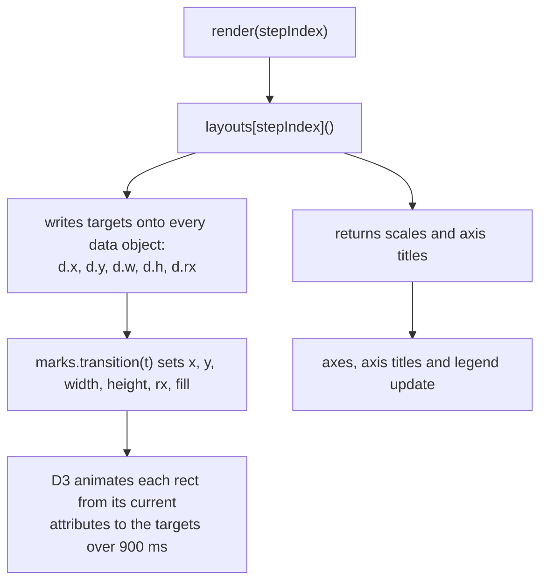

## 16. One scroll, traced through the code

The reader scrolls until the box of the third card reaches the trigger line:

| What happens | Code that runs |
| --- | --- |
| Scrollama sees the box cross the line and calls your function | `handleStepEnter({ index: 2, direction: "down", element })` |
| Card 3 is highlighted, the other cards fade | `step.classed("is-active", (d, i) => i === 2)` |
| The step number is saved and passed on | `currentStep = 2; render(2);` |
| The layout for step 2 writes new targets onto all 82 data objects | `layouts[2]()` runs `columnLayout()` |
| D3 animates every rect from where it is to its new target | `marks.transition(t).attr("x", d => d.x) ...` |
| The label on the trigger line updates | `triggerLabel.text(...)` |
| Later, the reader scrolls back up past card 2 | `handleStepEnter({ index: 1, direction: "up" })`, then `render(1)` |


The same trace as a sequence diagram:

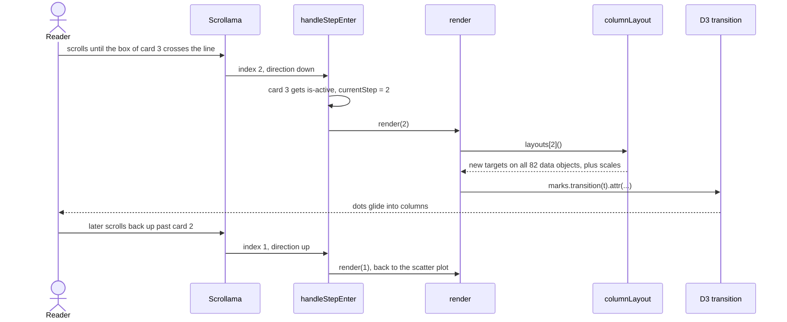

Nothing else runs when a step is entered.

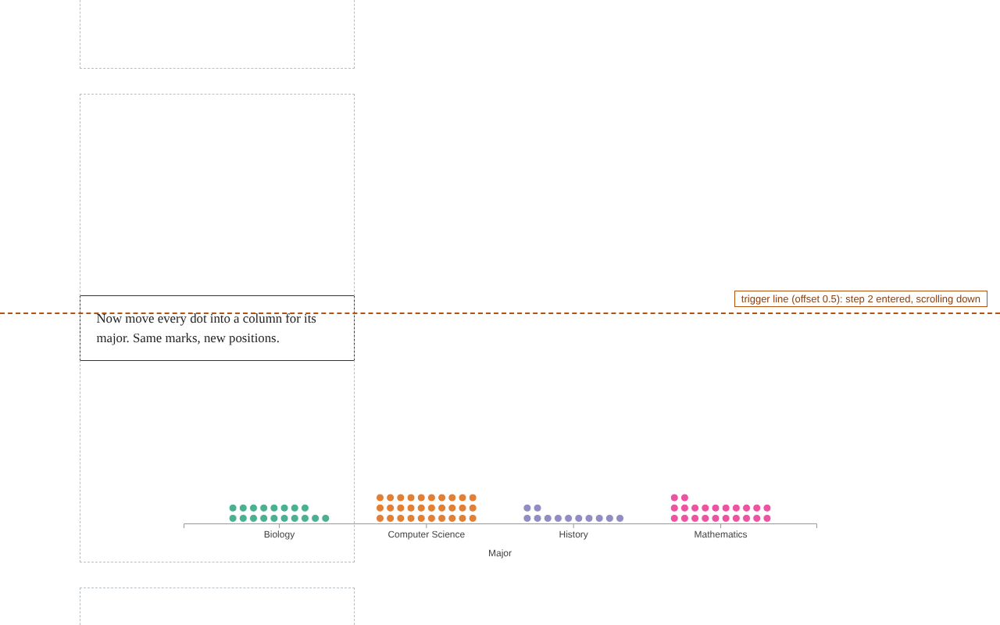

## 17. Exercise: add a step of your own

Add a fifth step that turns the count bars into bars of **average exam score** per major. It takes three edits and no changes to the Scrollama code.

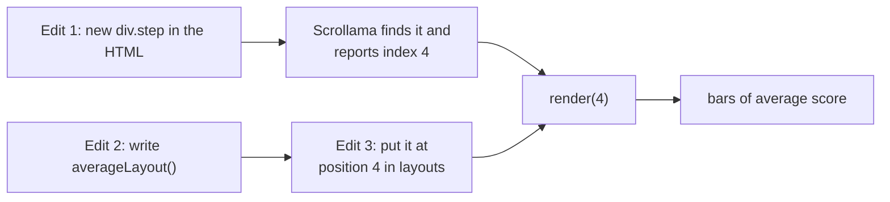

**1. HTML:** add a card after the last one. It becomes index 4.

```html
<div class="step" data-step="4">
  <p>Each bar now shows the average exam score for the major.</p>
</div>
```

**2. JavaScript:** write a layout function. It has the same shape as `barLayout`: compute scales, then write `d.x`, `d.y`, `d.w`, `d.h` and `d.rx` for every mark.

```js
function averageLayout() {
  const x = d3.scaleBand().domain(majors).range([0, width]).padding(0.3);
  const y = d3.scaleLinear().domain([0, 100]).range([height, 0]);
  // average score and number of students for each major
  const mean = d3.rollup(data, v => d3.mean(v, d => d.score), d => d.major);
  const n = d3.rollup(data, v => v.length, d => d.major);
  marks.each(d => {
    // split the bar's height into n equal slices, one per student
    const slice = (height - y(mean.get(d.major))) / n.get(d.major);
    d.x = x(d.major); d.w = x.bandwidth();
    d.y = height - (d.rank + 1) * slice; d.h = slice;
    d.rx = 0;
  });
  return { x, y, xTitle: "Major", yTitle: "Average exam score" };
}
```

**3. JavaScript:** add it to the array at position 4.

```js
const layouts = [scatterLayout, scatterLayout, columnLayout, barLayout, averageLayout];
```

Scrollama finds the new card by itself, because it matches the `.step` selector, and reports index 4 when the card is reached. The array is what connects that 4 to the new chart state.

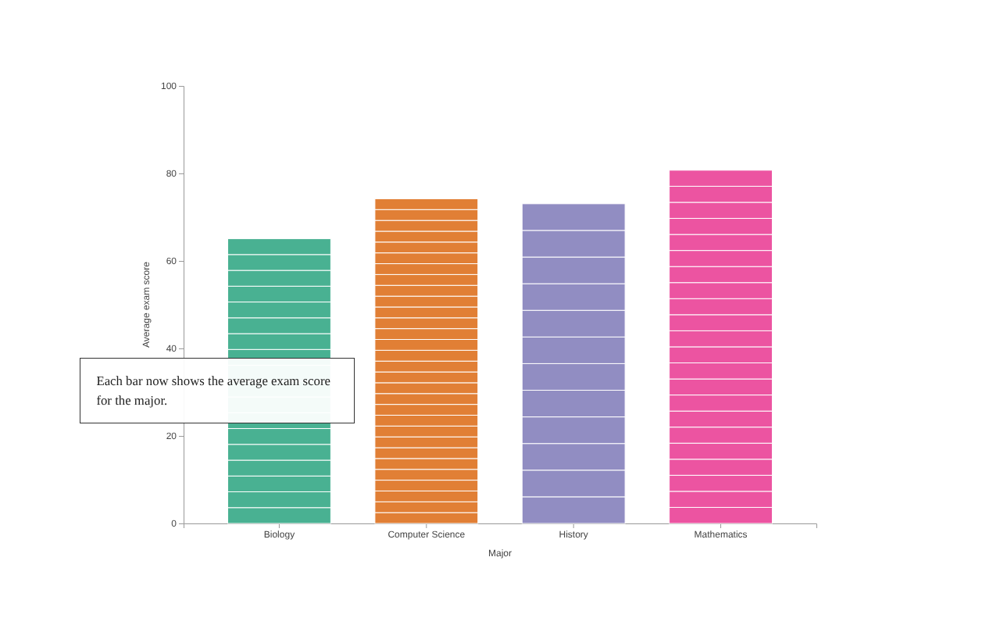

Next, try a step that sorts the bars from tallest to shortest.

## 18. Common problems

| What you see | Usual cause |
| --- | --- |
| The chart scrolls away instead of sticking | A parent has `overflow: hidden` or `auto`, or the figure has no `top` value |
| The chart is wrong after scrolling up | `render()` changes the previous state instead of drawing the state for the step index |
| A step fires while its card is still below the line | Expected: the edge of the taller step box crossed the line, not the card (see section 9) |
| Steps fire at the wrong moments | Step sizes changed after `setup()`; size first, then call `setup()` |
| The last step never fires | There is no room below it: keep an outro section so the last box can reach the trigger line |
| Nothing happens at all | A selector name does not match the HTML (section 7), or a library script failed to load (check the browser console) |
| Triggers jump on phones | Use a pixel offset such as `"300px"` instead of a fraction |

## 19. Reference: options and callbacks

Options for `scroller.setup()` (Scrollama 3.2.0):

| Option | What it does | Default |
| --- | --- | --- |
| `step` | Selector or list of elements that act as steps (required) | none |
| `offset` | Where the trigger line sits: 0 is the top of the screen, 1 the bottom, or a pixel string like `"200px"` | 0.5 |
| `progress` | Also report how far the reader is through each step, from 0 to 1 | false |
| `threshold` | How many pixels between progress updates (smaller is smoother) | 4 |
| `once` | Fire each step only the first time it is reached | false |
| `debug` | Draw Scrollama's own trigger line while you build | false |
| `container`, `root` | Use when the story scrolls inside a box with overflow instead of the whole page | none |

A single step can override the offset with a data attribute: `<div class="step" data-offset="0.25">`.

The three callbacks:

```js
scroller
  .onStepEnter(({ element, index, direction }) => { /* ... */ })
  .onStepExit(({ element, index, direction }) => { /* ... */ })
  .onStepProgress(({ element, index, progress }) => { /* ... */ });
  // onStepProgress fires only with progress: true in setup()
```

- `index`: which step, counting from 0. This is what picks the chart's state.
- `direction`: `"down"` or `"up"`.
- `element`: the step's DOM node, handy for reading attributes such as `element.dataset.step`.
- `progress`: 0 to 1 inside a step, for continuous effects such as a line that draws itself.

## Further reading

- [Scrollama repository and API reference](https://github.com/russellsamora/scrollama)
- [Scrollama sticky-overlay example](https://russellsamora.github.io/scrollama/sticky-overlay), the pattern this tutorial follows
- [The Pudding: how to use position sticky for scrollytelling](https://pudding.cool/process/scrollytelling-sticky/)
- [D3 transitions](https://d3js.org/d3-transition)
