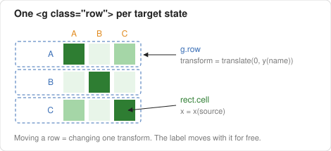
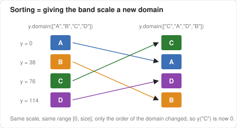
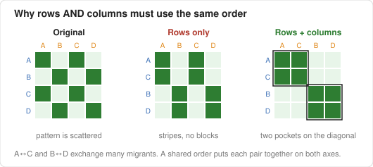
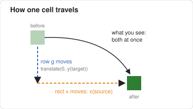
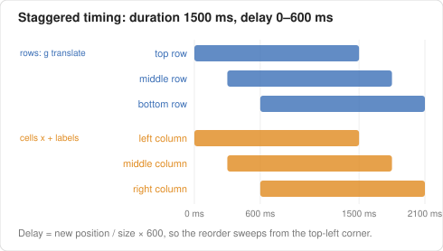

# Sorting an Adjacency Matrix with D3

This guide explains how [index_interactionSorting.html](./index_interactionSorting.html) reorders the state-to-state migration matrix and animates the change.

The goal of sorting is to find **pockets**: groups of states that exchange many migrants with each other. A good order places such a group in neighboring rows *and* neighboring columns, so their cells form a dark block on the diagonal.

---

## 1. The structure: one group per row

Every target state (one CSV row) gets its own `<g class="row">`. That group holds the state's label and all of its cells.



```javascript
const row = mainGroup.selectAll(".row")
    .data(rows, d => d.name)          // key by state name
    .join("g")
    .attr("class", "row")
    .attr("transform", d => `translate(0,${y(d.name)})`)

row.selectAll(".cell")
    .data(d => d.cells)
    .join("rect")
    .attr("class", "cell")
    .attr("x", d => x(d.source))
```

There are two things to notice:

- A row's **vertical** position lives on the group (`transform`), so moving a row is a single attribute change, and its label moves with it.
- A cell's **horizontal** position lives on the rect (`x`), so moving a column means updating `x` on every cell from that source state.

The key function `d => d.name` makes D3 match each row to its data by state name, not by index. After a sort, each element keeps its own state.

---

## 2. Positions come from band scales

Both axes use `d3.scaleBand()`. A band scale maps each name in its **domain** to a slot in its **range**:

```javascript
const x = d3.scaleBand().domain(columnOrder(orders.original)).range([0, size]).padding(0.15)
const y = d3.scaleBand().domain(orders.original).range([0, size]).padding(0.15)
```

The slot positions are fixed, so sorting doesn't change them. Sorting only changes **which name owns which slot**.



The available orders are computed once, when the data loads. Each order is a plain array of state names:

```javascript
const orders = {
    original: rows.map(r => r.name),
    name:     rows.map(r => r.name).sort(d3.ascending),
    inflow:   rows.slice().sort((a, b) => b.total - a.total).map(r => r.name),
    outflow:  rows.map(r => r.name).sort((a, b) => (outflow.get(b) || 0) - (outflow.get(a) || 0))
}
```

| Button | Sorted by |
|---|---|
| Original | CSV order |
| Name | alphabetical |
| Total In-migration | row sum: everyone who moved **into** the state |
| Total Out-migration | column sum: everyone who moved **out of** the state |

---

## 3. Why rows and columns use the same order

If you reorder only the rows, cells that belong together end up in the same rows but stay scattered across the columns, so you see stripes instead of blocks. A pocket appears only when the **same** permutation is applied to both axes.



The code gives `x` the same order as `y`. The helper `columnOrder` keeps only names that are also columns and appends any leftover columns, so a mismatch in the CSV can't drop a column:

```javascript
const columnOrder = names => names.filter(n => States.includes(n))
    .concat(States.filter(s => !names.includes(s)))
```

---

## 4. Sorting and transition together

When a button is clicked, `order(key)` runs two steps:

1. **Update the scales.** Both domains are replaced, so `x(...)` and `y(...)` now return the new positions.
2. **Transition the elements to those positions.** No elements are created or removed. The same row groups, cells, and labels animate to new attribute values.

```javascript
function order(key) {
    y.domain(orders[key])
    x.domain(columnOrder(orders[key]))

    const t = svg.transition().duration(1500)

    row.transition(t)
        .delay(d => y(d.name) / size * 600)
        .attr("transform", d => `translate(0,${y(d.name)})`)
      .selectAll(".cell")
        .delay(d => x(d.source) / size * 600)
        .attr("x", d => x(d.source))

    column.transition(t)
        .delay(d => x(d) / size * 600)
        .attr("transform", d => `translate(${x(d) + x.bandwidth() / 2},-6) rotate(-60)`)
}
```

### One cell, two motions

Each cell moves in two directions at the same time:

- vertically, because its parent row group is translated
- horizontally, because its own `x` attribute changes

Because both transitions run together, the cell appears to slide diagonally to its new place.



### Staggered timing

All transitions share the same duration (`t`, 1500 ms), but each one has its own **delay** based on its *new* position:

- rows: `delay = y(name) / size × 600`, so the top row starts first and the bottom row last
- cells and column labels: `delay = x(source) / size × 600`, so the left column starts first and the right column last

The result is a wave that sweeps from the top-left corner, which makes individual states easier to follow than if everything moved at once.



> **Why `transition.selectAll(".cell")` works:** calling `selectAll` on a transition creates child transitions for the matching elements. They inherit the parent's timing, and here we override only their `delay`. This differs from `selection.selectAll(...).data(...)`. Transitions can't bind data, so animations always work on elements that already exist.

---

## 5. Things to try

1. Change `600` to `0` in the delays, then sort again. Is it easier or harder to follow a single state?
2. Replace `rows.slice().sort(...)` with an order based on a specific state. For example, sort by how many people moved from Massachusetts into each state.
3. Add a cluster-based order, for example with [reorder.js](https://github.com/jdfekete/reorder.js) or by grouping states by Census region. Which pockets appear?

**Reference:** Mike Bostock, [Les Misérables Co-occurrence](https://bost.ocks.org/mike/miserables/), the classic sortable adjacency matrix this example follows.
